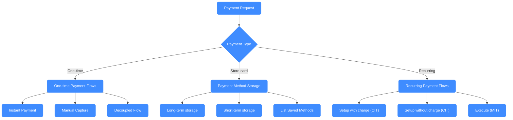
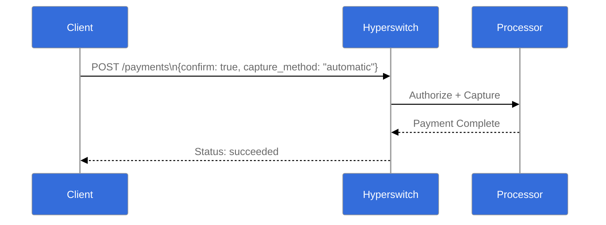
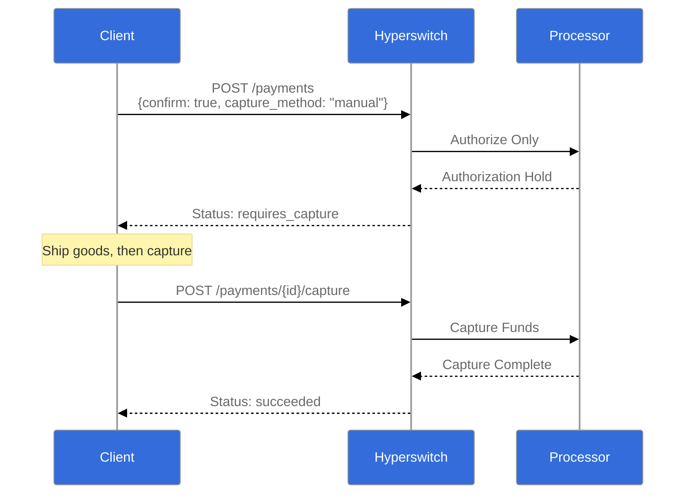
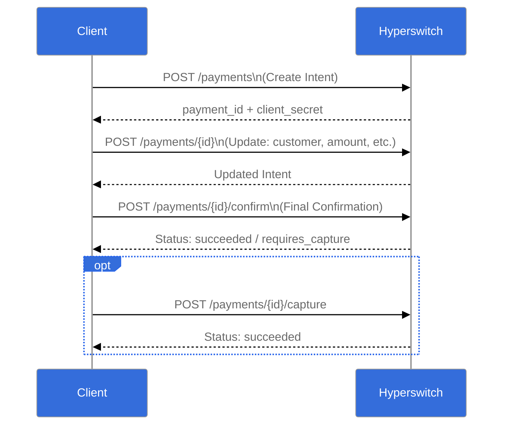
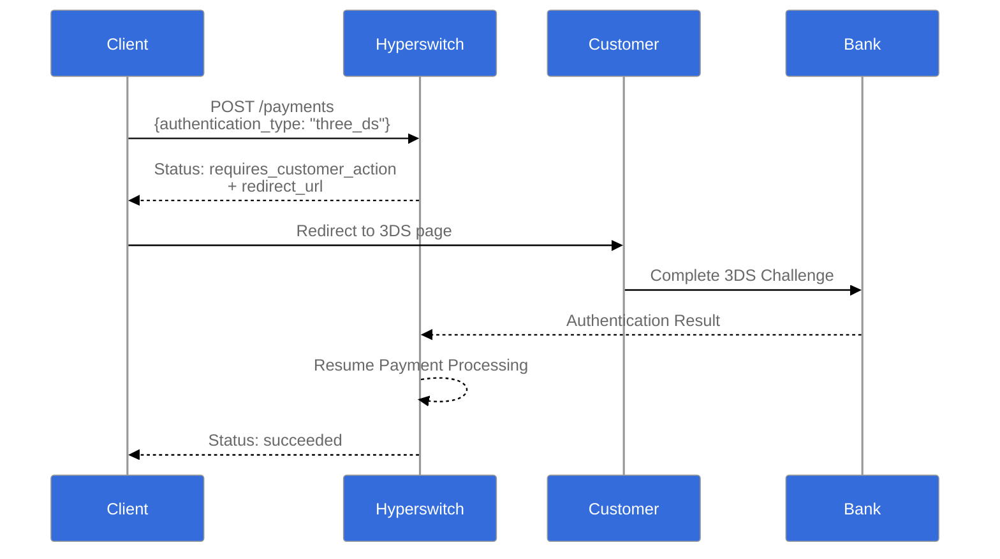
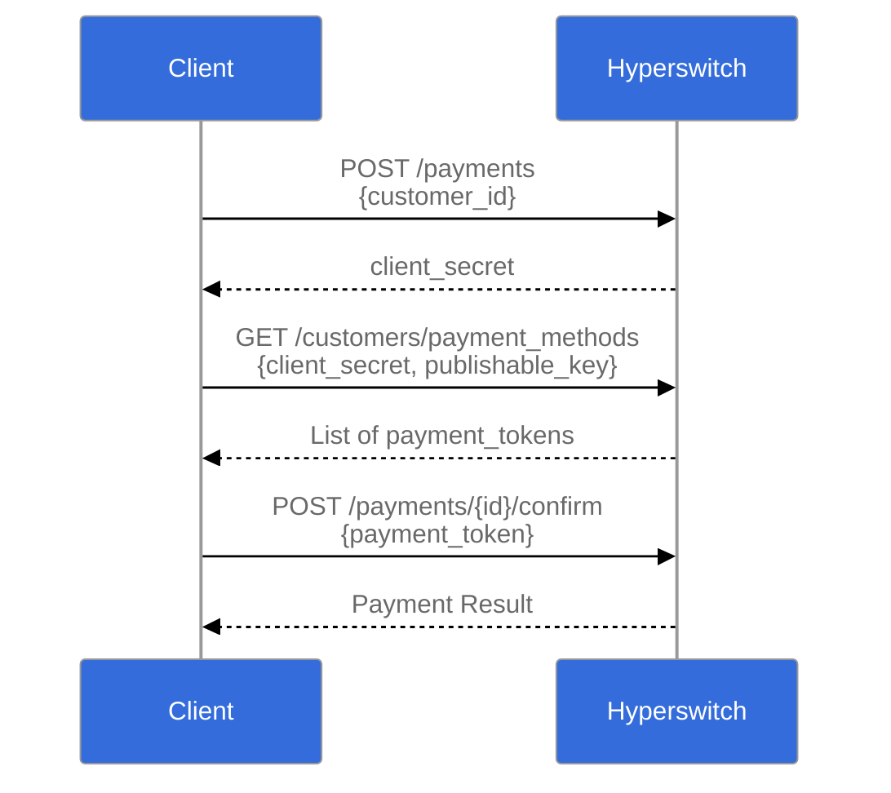
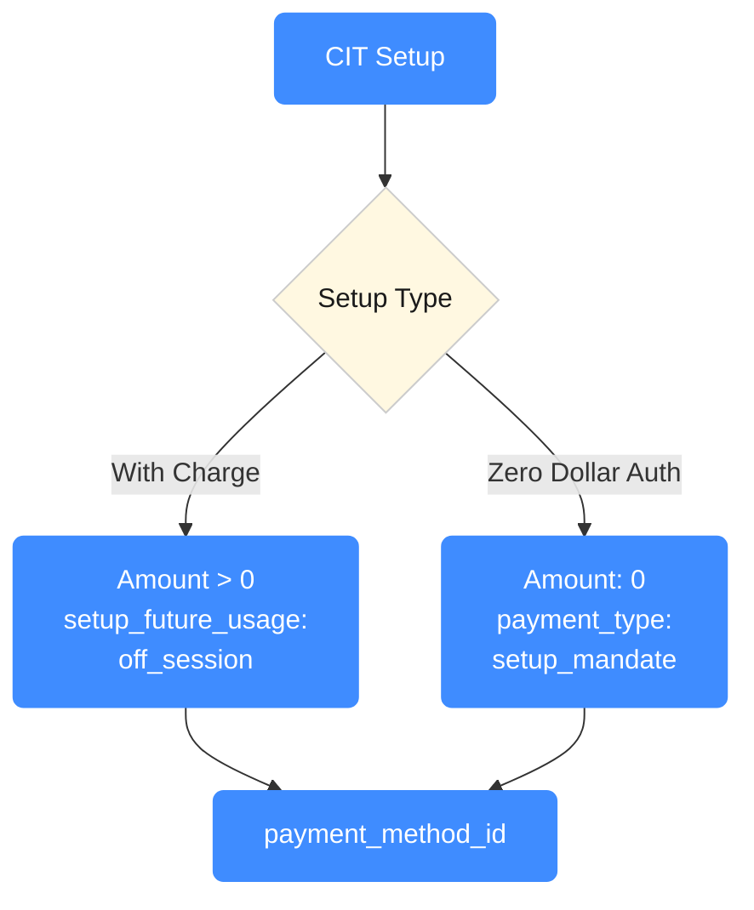
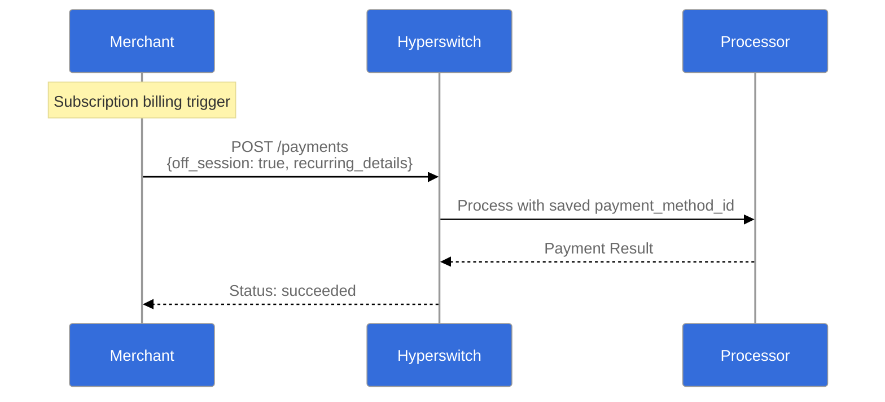
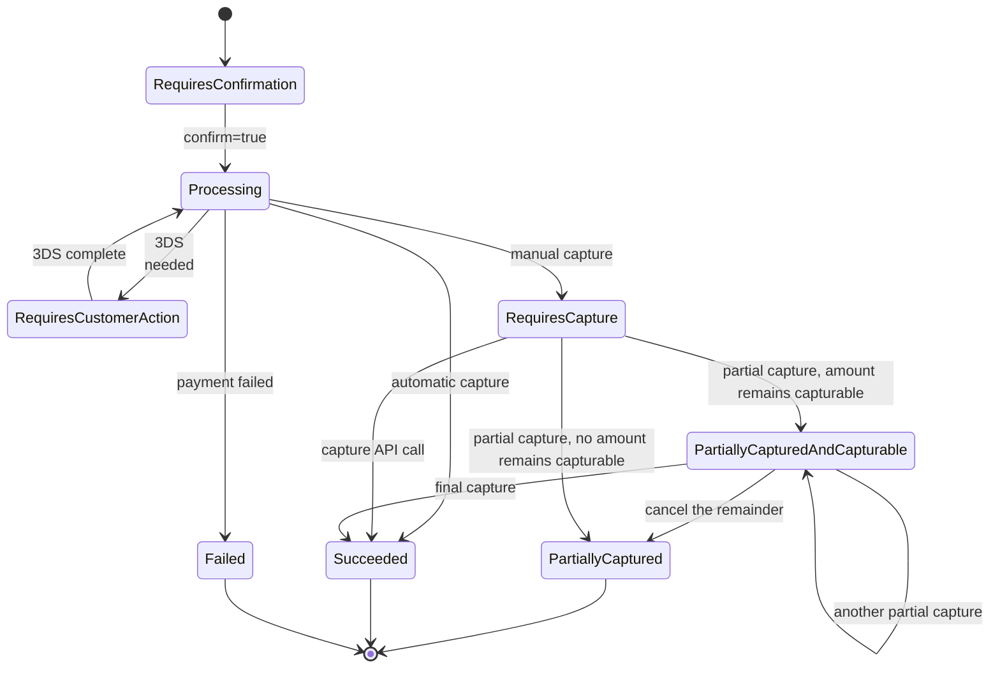

<!-- truth manifest; hyperswitch 7a348f02a94edf7b2593e65ca6ffaf8d8f9ee6f8; spec api-reference/v1/openapi_spec_v1.json@7a348f02a94edf7b2593e65ca6ffaf8d8f9ee6f8
     symbols: capture methods automatic, manual, manual_multiple, scheduled, sequential_automatic = api-reference/v1/openapi_spec_v1.json:17937-17946; crates/common_enums/src/enums.rs:843-859
     symbols: scheduled capture method rejected with 501 Not Implemented on payment create and update = crates/router/src/routes/payments.rs:86-88,967-969
     symbols: terminal payment statuses succeeded, failed, cancelled, cancelled_post_capture, partially_captured, expired = crates/common_enums/src/enums.rs:2150-2198,2205-2225
     symbols: partially_captured_and_capturable = api-reference/v1/openapi_spec_v1.json:27103-27123; crates/common_enums/src/enums.rs:2177-2182,2205-2225; crates/common_enums/src/transformers.rs:2129-2130
     symbols: refund insertion database uniqueness violation returns DuplicateRefundRequest, public response HTTP 400 code HE_01 = crates/router/src/core/refunds.rs:1828-1835; crates/hyperswitch_domain_models/src/errors/api_error_response.rs:67-68,428
     symbols: refund amount and refund count validated before the insert (RefundAmountExceedsPaymentAmount, MaximumRefundCount) = crates/router/src/core/refunds.rs:1706-1717
     symbols: MultipleCaptureData::get_attempt_status, Charged when captured equals authorized, PartialChargedAndChargeable when any capture has settled, else CaptureInitiated = crates/router/src/core/payments/types.rs:133-147
     symbols: scheduled capture method also rejected with 501 Not Implemented on payment confirm and payment-link create = crates/router/src/routes/payments.rs:262-264,1273-1275
     symbols: refund amount validation sums every non-failed refund on the transaction, so a same-id retry of a full refund fails on the amount check before the insert = crates/router/src/core/utils/refunds_validator.rs (validate_refund_amount); crates/router/src/core/refunds.rs:1680-1717
     symbols: refunds require succeeded or partially_captured, and are blocked once a post-capture void is issued = crates/router/src/core/refunds.rs:402-414,423; crates/hyperswitch_domain_models/src/payments.rs:442
     symbols: cancel is rejected from failed, succeeded, cancelled, processing, requires_merchant_action, review; cancel_post_capture is allowed only from succeeded, partially_captured = crates/router/src/core/payments/operations/payment_cancel.rs:73-83; crates/router/src/core/payments/operations/payment_cancel_post_capture.rs:77-84
     symbols: a void with amount already captured becomes PartialCharged, so cancelling a partly captured manual_multiple payment ends as partially_captured; a single capture below the total becomes PartialCharged = crates/router/src/connector/utils.rs:163-168,174-189
     symbols: capture_method can be updated only while requires_payment_method, requires_confirmation, requires_customer_action = crates/router/src/core/payments/operations/payment_update.rs:118-126
     symbols: expired is produced only by connector status mappings (chargebee, paypal, recurly), no Hyperswitch-side expiry = crates/hyperswitch_connectors/src/connectors/chargebee/transformers.rs:1205; paypal/transformers.rs:3495; recurly/transformers.rs:305
     symbols: capture_method is set from the confirm request, and confirm is refused from cancelled, succeeded, processing, requires_capture, requires_merchant_action, review = crates/router/src/core/payments/operations/payment_confirm.rs:142-152,462
     symbols: manual retry of a failed intent: profile flag is_manual_retry_enabled, cutoff from created_at (token retry uses intent fulfillment time, raw retry uses half the session expiry, both default 15 minutes), new attempt only after authentication or authorization failure, response field manual_retry_allowed also false for merchants in connector_request_reference_id_config; RefundAmountExceedsPaymentAmount is public IR_13 = crates/router/src/core/payments/helpers.rs:5550-5680,5685-5703,5963-6021; crates/router/src/core/payments/transformers.rs:4311-4319; crates/api_models/src/admin.rs:2567,3358; crates/common_utils/src/consts.rs:85,91; crates/router/src/configs/settings.rs:1414-1416; crates/hyperswitch_domain_models/src/errors/api_error_response.rs:216-217,617-619
     symbols: payment create is POST /payments, no /payments/create route in v1 = crates/router/src/routes/app.rs:996,1062; crates/openapi/src/routes/payments.rs:6-8
     symbols: failure reason fields on the payment response = crates/api_models/src/payments.rs:283-298 (error_code, error_message, unified_code, unified_message)
     checked: 2026-10-22 -->

# Pay-Then-Vault

Juspay Hyperswitch provides flexible payment processing with multiple flow patterns to accommodate different business needs. The system supports one-time payments, saved payment methods, and recurring billing through a comprehensive API design.


**Integration Path**

**Client-Side SDK Payments (Tokenise Post Payment)**

Refer to Payments (Cards) section if your flow requires the SDK to initiate payments directly. In this model, the SDK handles the payment trigger and communicates downstream to the Hyperswitch server and your chosen Payment Service Providers (PSPs). This path is ideal for supporting dynamic, frontend-driven payment experiences.


### One-Time Payment Patterns

#### 1. Instant Payment (Automatic Capture)

**Use Case:** Simple, immediate payment processing

**Endpoint:** `POST /payments`&#x20;

**Required Fields:**

* `confirm: true`
* `capture_method: "automatic"`
* `payment_method`

**Final Status:** `succeeded`

#### 2. Two-Step Manual Capture

**Use Case:** Deferred capture (e.g., ship before charging)

**Flow:**

1. **Authorize:** `POST /payments` with `capture_method: "manual"`
2. **Status:** `requires_capture`
3. **Capture:** `POST /payments/{payment_id}/capture`
4. **Final Status:** `succeeded`

Read more: [here](https://docs.hyperswitch.io/~/revisions/2M8ySHqN3pH3rctBK2zj/about-hyperswitch/payment-suite-1/payments-cards/manual-capture)

#### 3. Fully Decoupled Flow

**Use Case:** Complex checkout journeys with multiple modification steps. Useful in headless checkout or B2B portals where data is filled progressively.

**Endpoints:**

* **Create:** `POST /payments`
* **Update:** `POST /payments/{payment_id}`
* **Confirm:** `POST /payments/{payment_id}/confirm`
* **Capture:** `POST /payments/{payment_id}/capture` (if manual)

#### 4. 3D Secure Authentication Flow

**Use Case:** Enhanced security with customer authentication

**Additional Fields:**

* `authentication_type: "three_ds"`

**Status Progression:** `processing` → `requires_customer_action` → `succeeded`

Read more: [here](https://docs.hyperswitch.io/~/revisions/9QlGypixZFcbkq8oGjaF/explore-hyperswitch/workflows/3ds-decision-manager)

### Recurring Payments and Payment Storage

#### 1. Saving Payment Methods

**During Payment Creation:**

* Add `setup_future_usage: "off_session"` or `"on_session"`
* Include `customer_id`
* **Result:** `payment_method_id` returned on success

**Understanding `setup_future_usage`:**

* **`on_session`**: Use when the customer is actively present during the transaction. This is typical for scenarios like saving card details for faster checkouts in subsequent sessions where the customer will still be present to initiate the payment (e.g., card vaulting for e-commerce sites).
* **`off_session`**: Use when you intend to charge the customer later without their active involvement at the time of charge. This is suitable for subscriptions, recurring billing, or merchant-initiated transactions (MITs) where the customer has pre-authorized future charges.

#### 2. Using Saved Payment Methods

**Steps:**

1. **Initiate:** Create payment with `customer_id`
2. **List:** Get saved cards via `GET /customers/payment_methods`
3. **Confirm:** Use selected `payment_token` in confirm call

#### PCI Compliance and `payment_method_id`

Storing `payment_method_id` (which is a token representing the actual payment instrument, which could be a payment token, network token, or payment processor token) significantly reduces your PCI DSS scope. Hyperswitch securely stores the sensitive card details and provides you with this token. While you still need to ensure your systems handle `payment_method_id` and related customer data securely, you avoid the complexities of storing raw card numbers. Always consult with a PCI QSA to understand your specific compliance obligations.

### Recurring Payment Flows

#### 3. Customer-Initiated Transaction (CIT) Setup

Read more: [here](https://docs.hyperswitch.io/~/revisions/j00Urtz9MpwPggJzRCsi/about-hyperswitch/payment-suite-1/payments-cards/recurring-payments)

#### 4. Merchant-Initiated Transaction (MIT) Execution

Read more: [here](https://docs.hyperswitch.io/~/revisions/j00Urtz9MpwPggJzRCsi/about-hyperswitch/payment-suite-1/payments-cards/recurring-payments)

### Status Flow Summary

### What each payment status means for you

Once a payment reaches one of these six statuses, Hyperswitch will not change it again. Use the table to decide your next step.

| Status | What happened | Your next step |
| --- | --- | --- |
| `succeeded` | The customer was charged the full amount. | You can refund it if you need to. |
| `partially_captured` | You charged part of the amount, and the rest can no longer be charged. You get here when a `manual` capture takes less than the hold, or when you cancel a `manual_multiple` payment after charging part of it. | You can refund what was charged. |
| `failed` | The processor declined the payment, or something went wrong during the attempt. The reason is in `error_code` and `error_message` on the payment response, with a plain-language version in `unified_message`. | Look at `manual_retry_allowed` in the payment response. If it is `true`, confirm the same payment again with a new payment method, within the retry window counted from when the payment was created. If it is `false` or missing, or the retry is refused with code `IR_16`, create a new payment. See [Manual retries](../../workflows/smart-retries/manual-user-triggered-retries.md) for the SDK and API flow. |
| `cancelled` | You cancelled the payment before charging anything. Hyperswitch asked the processor to release the hold. | Nothing more to do. Create a new payment if the customer still wants to pay. |
| `cancelled_post_capture` | You cancelled the payment after it was charged. | Nothing more to do. Refunds are not possible on this payment, and they stop working the moment you request the cancel. |
| `expired` | The processor let the hold expire before you charged it. Hyperswitch does not expire payments on its own. | Create a new payment. |

One more status is worth knowing. `partially_captured_and_capturable` only appears with `manual_multiple`. It means you have charged part of the amount and can keep charging, up to the amount that was authorized. Once your charges add up to that amount, the payment becomes `succeeded`.

### Choosing when to charge the customer

The `capture_method` field decides when money actually moves. Pick it when you create the payment. You can still change it on an update or confirm call, but once the customer's card has been authorized it is locked.

* **Charge right away.** Use `automatic`. This is the default and fits most checkouts: authorization and charge happen in one step.
* **Hold now, charge once later.** Use `manual`, for example when you want to ship before charging. The payment waits in `requires_capture`. When you are ready, call `POST /payments/{payment_id}/capture` once, for the full amount or less. Whatever you do not take in that one call cannot be charged later, and the payment ends as `partially_captured`. The processor decides when it releases the rest of the hold.
* **Hold now, charge in parts.** Use `manual_multiple`, for example for an order that ships in several boxes. Call the capture endpoint each time you ship, until the charges add up to the hold. If you decide not to charge the rest, cancel the payment. What you already charged stays refundable.
* **`sequential_automatic`** behaves like `automatic` for most processors. It runs the authorization and the charge as two back-to-back steps. Use it only if a connector guide tells you to.
* **Do not use `scheduled`.** It appears in the API reference but is not built. Create, update, confirm and payment-link requests that carry it all return `501 Not Implemented`. If you want to charge at a later time, use `manual` or `manual_multiple` and call capture when the time comes. See [Manual Capture](manual-capture/README.md).

### If a refund request times out

You called `POST /refunds` and never got an answer. You do not know whether the refund went through, and you do not want to refund the customer twice.

* **Send the same request again, with the same `refund_id`.** Hyperswitch never creates a second refund for an ID it has already seen, so this is always safe.
* **Then check the result** with `GET /refunds/{refund_id}`. If the retry comes back with one of these errors, the first refund exists and you are done:
  * HTTP 400, code `HE_01`, "Duplicate refund request. Refund already attempted with the refund ID".
  * HTTP 400, code `IR_13`, "The refund amount exceeds the amount captured". You will usually see this one when you retry a full refund, because the first refund already used up the refundable balance.
* **Do not retry with a new `refund_id`.** If the first request did go through, the second one can refund the customer again for whatever balance is left.

### 3DS and recurring payments

* **3DS:** when the customer finishes the challenge and comes back to your site, Hyperswitch completes the authorization for you. Read the payment status to see the result. You do not need to confirm the payment again.
* **Recurring:** charging a saved card while the customer is away follows the card networks' rules for merchant-initiated transactions. See [Recurring Payments](recurring-payments.md) for the setup.
