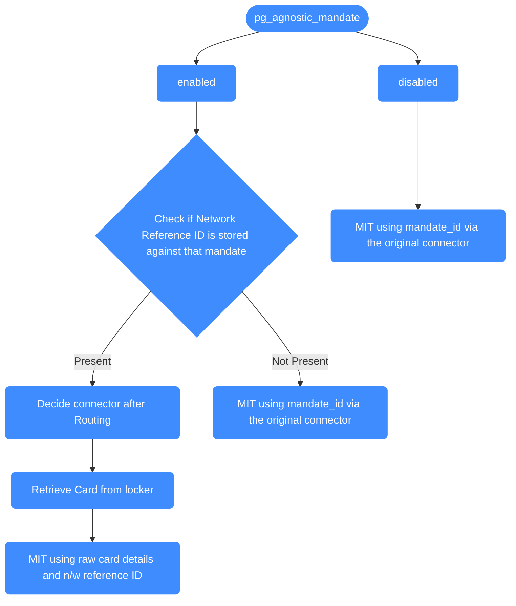

# Recurring payments

A recurring payment is two things: a first payment where the customer is present and agrees to be charged again, and the later charges your server starts on its own. This page covers how to set up the first payment, how to capture the customer's consent, the ways you can reference the saved method on later charges, and how to route those charges across processors.

The amount and timing of later charges are up to you when you charge by saved payment method ID or by card plus network transaction ID. If you set a mandate amount on the first payment and charge by mandate ID, a single-use mandate allows one charge up to that amount, a multi-use mandate caps the running total at it, and every charge must use the mandate's currency. Charging by a processor token also keeps the original currency.

### Programmatic Card-on-File Setup with Immediate Charge (CIT + Save)

When setting up subscription there are two distinct implementation flows. The correct flow depends on whether you intend to charge the customer immediately or simply validate their details for later use.

#### 1. The Setup with Charge Flow

**Use Case:** Use this when you need to collect a payment immediately (e.g., the first month of a subscription or a setup fee) while simultaneously saving the card details for future automatic charges. For this call Payments API with the below configuration parameters.

**Required API Configuration**

Include below parameter and values while calling the [payments](https://api-reference.hyperswitch.io/v1/payments/payments--create) API.

| Parameter            | Value                  |
| -------------------- | ---------------------- |
| `amount`             | >0 (Greater than zero) |
| `setup_future_usage` | `off_session`          |

**Run-Ready API Example (CIT with Charge)**

<pre class="language-bash"><code class="lang-bash">curl --location 'https://sandbox.hyperswitch.io/payments' \
--header 'Content-Type: application/json' \
--header 'Accept: application/json' \
--header 'api-key: &#x3C;enter your Hyperswitch API key here>' \
--data-raw '{
    "amount": 6540,
    "currency": "USD",
    "profile_id": "&#x3C;enter the relevant profile id>",
<strong>    "setup_future_usage": "off_session",
</strong>    "customer_id": "customer123",
    "description": "My first payment request",
    "return_url": "https://example.com"
}'
</code></pre>

#### 2. Zero Dollar Authorization (Mandate-Only Setup)

**Use Case:** Use this for free trials, pay-later models, or delayed billing. This flow validates the payment method details without charging the customer's card.

**Required API Configuration**

Send these on the create call. Hyperswitch works out from them that this is a mandate setup; there is no separate field to set.

| Parameter            | Value         |
| -------------------- | ------------- |
| `amount`             | `0`           |
| `setup_future_usage` | `off_session` |

The [zero-amount authorization](authorizations/zero-amount-authorization-1.md) page walks through the full create-then-confirm sequence.

**Run-Ready API Example (Zero Auth Mandate)**

<pre class="language-bash"><code class="lang-bash">curl --location 'https://sandbox.hyperswitch.io/payments' \
--header 'Content-Type: application/json' \
--header 'Accept: application/json' \
--header 'api-key: &#x3C;enter your Hyperswitch API key here>' \
--data-raw '{
<strong>    "amount": 0,
</strong>    "currency": "USD",
    "confirm": false,
    "customer_id": "customer123",
    "email": "customer@example.com",
    "name": "John Doe",
    "phone": "9999999999",
    "phone_country_code": "+1",
    "description": "Card validation for a free trial",
    "profile_id": "&#x3C;enter the relevant profile id>",
<strong>    "setup_future_usage": "off_session"
</strong>}'
</code></pre>

This call only creates the payment. It sits in `requires_payment_method` until you confirm it with the card details and the customer's consent, which is what validates the card and sets up the mandate. The confirm call is the same as in the [zero-amount authorization](authorizations/zero-amount-authorization-1.md) walkthrough.

Once the CIT is successful, Hyperswitch returns a `payment_method_id` . This `payment_method_id` can be used by the merchant for all subsequent MIT recurring payments. Hyperswitch also returns the `network_transaction_id` (NTID) in its response to allow PCI compliant merchants to direct pass card + NTID for processing MIT recurring payments

The `payment_method_id` serves as a unique identifier mapped to a specific combination of a Customer ID and a unique Payment Instrument (e.g., a specific credit card, digital wallet, or bank account). A single customer can have multiple payment methods, each assigned a distinct ID. However, the same payment instrument used by the same customer will always resolve to the same `payment_method_id`. This uniqueness applies across all payment types, including cards, wallets, and bank details.

For example, you can refer the below table -

| **Customer ID** | **Payment Instrument**            | **Payment Method ID** |
| --------------- | --------------------------------- | --------------------- |
| 123             | Visa ending in 4242               | `PM1`                 |
| 123             | Mastercard ending in 1111         | `PM2`                 |
| 456             | Visa ending in 4242               | `PM3`                 |
| 123             | PayPal Account (`user@email.com`) | `PM4`                 |

Internally the payment\_method\_id is mapped to a bunch of credentials - PSP token, Raw card + NTID, Network token + NTID depending on functionalities enabled for the merchant.

### Customer Consent Capture (Mandate Compliance)

Hyperswitch records the customer's agreement to be charged again as a `customer_acceptance` object on the confirm call. Without it, the card is used for this payment and nothing is set up for later.

**If you build your own checkout**, add the object to the confirm request yourself. Both flows above use the same shape:

```bash
"customer_acceptance": {
    "acceptance_type": "online",
    "accepted_at": "2026-10-23T10:15:00.000Z",
    "online": {
        "ip_address": "203.0.113.10",
        "user_agent": "Mozilla/5.0 (Macintosh; Intel Mac OS X 10_15_7) Safari/605.1.15"
    }
}
```

When `acceptance_type` is `online`, the `online` object is required. A full confirm request with this object in place is on the [save a payment method](save-a-payment-method/README.md#saving-a-payment-method-for-future-mit-payments) page.

**If you use the Hyperswitch SDK**, the checkout shows a "Save this card" checkbox to signed-in customers by default, and the SDK adds their consent to the confirm call when they tick it. You do not send `customer_acceptance` yourself. If you have hidden the checkbox with [`displaySavedPaymentMethodsCheckbox`](../../payment-experience/payment/web/customization.md#display-saved-payment-methods-checkbox), the SDK still records consent for a signed-in customer on an off-session payment, so make sure you have their agreement some other way.

***

### Merchant-Initiated Transactions (MIT) – Decoupled Execution

Once a customer has agreed to be charged again, you can charge them from your server at any time. The charge does not have to go through the same processor as the first payment, and the first payment does not even need to have happened on Hyperswitch.

To start a charge, call `/payments` with `off_session: true` and tell Hyperswitch what you are holding in the `recurring_details` object. Pick the type that matches:

* **A reference Hyperswitch gave you.** Use `payment_method_id`, or `mandate_id` if you set up a mandate.
* **A token the processor gave you.** Use `processor_payment_token`.
* **The card, network token, or decrypted wallet token itself**, together with the network transaction ID from the first payment. Use `network_transaction_id_and_card_details`, `network_transaction_id_and_network_token_details`, or `network_transaction_id_and_decrypted_wallet_token_details`. The wallet type covers Apple Pay and Google Pay.
* **A vault alias.** Use `network_transaction_id_and_vault_card_details`, or `network_token_with_vault_card_fallback` to try a network token first and fall back to the vaulted card.
* **Card data and nothing else.** Use `card_with_limited_data`. Only some processors accept this.

Each type needs different fields and works with different processors. The [full table](save-a-payment-method/README.md#all-supported-recurring_details-types) on the save a payment method page lists all nine, and that page walks through the common ones with complete requests.


**Using Stripe?** Stripe has to enable the MIT exemption on your account before it will accept a card plus network transaction ID. If you see `Received unknown parameter: payment_method_options[card][mit_exemption]`, ask Stripe support to enable the `mit_exemption` parameter and `payment_method_options[card][mit_exemption][network_transaction_id]`, and tell them you run merchant-initiated charges across processors using network transaction IDs.


***

### Connector-Agnostic MIT Routing

When a card is saved during a payment, the processor that ran it hands back a token that only it can use. Left alone, every later charge of that card has to go back to the same processor. If that processor is down, expensive for the transaction, or no longer the one you want, you are stuck.

Hyperswitch also keeps the network transaction ID the card network issued for the first payment. With connector-agnostic routing turned on, a later charge by `payment_method_id` can be sent to any processor on your profile that accepts a card plus network transaction ID. Your routing rules decide which one, and retries can move between them. With it off, charges by `payment_method_id` stay on the original processor.



#### Enabling Connector agnostic MITs

Turn it on per business profile. The call takes your merchant API key or a dashboard login.

```bash
curl --location 'https://sandbox.hyperswitch.io/account/<merchant_id>/business_profile/<profile_id>/toggle_connector_agnostic_mit' \
--header 'Content-Type: application/json' \
--header 'Accept: application/json' \
--header 'api-key: <enter your Hyperswitch API key here>' \
--data '{
    "enabled": true
}'
```

Hyperswitch stores the network transaction ID whether or not this is on, so cards saved before you enabled it are eligible too, provided the processor returned one at the time. Two things change once it is on: charges by `payment_method_id` can route across the processors in the [per-environment list](save-a-payment-method/README.md#processing-mit-payments-without-a-saved-payment-method), and saved cards that carry a network transaction ID or a processor mandate no longer ask the customer for CVV at checkout.

***

### Routing example - CITs are routed through PSP-1 and all MITs through PSP-2

The [Hyperswitch dashboard](https://app.hyperswitch.io/dashboard/routing/rule) provides UI to configure routing rules for PG Agnostic Recurring Payments. You can choose the profile for which you wish to configure the rule in the Smart Routing Configuration.

Then, you can configure the rule as shown below using the metadata field in the Rule-Based Configuration.

<figure><figcaption></figcaption></figure>

This rule would be used in conjunction with the other active routing rules that you have configured.

Once the rule is configured, you would need to send the following metadata as per the payment request:

#### **Metadata to be sent in CITs**

```
"metadata": {
    "is_cit": "true"
}
```

#### **Metadata to be sent in MITs**

```
"metadata": {
    "is_mit": "true"
}
```

According to the above configured rule all the CITs for the specific business profile should be routed through Stripe and MITs through Adyen.
