# Fraud Blocklist

Juspay Hyperswitch lets you block risky payments and card payouts before they are sent to a processor. You can block one specific card, a range of cards sharing a BIN prefix, or any card whose attributes fall outside your risk policy.

### What can you block?

| Blocking option | Use it to | Example |
| --- | --- | --- |
| **Card fingerprint** | Block one specific card | Block a card linked to repeated fraudulent payments |
| **Generic card BIN** | Block cards that share the same 6 to 10-digit BIN prefix, including a wallet's DPAN BIN | Block a risky issuer range while keeping the rule as narrow as possible |
| **Card attributes** | Block cards that share a property you choose, such as issuing country, card type, network, or funding source | Refuse every prepaid card, or every card issued outside the markets you sell to |

The first two options identify a card you have already seen.

Card attributes work the other way round. Instead of naming a card, you describe the kind of card you never want to accept. Hyperswitch reads those properties from the card's BIN on every payment, so the rule catches cards you have never seen before and cards issued after you wrote the rule.

That makes it standing policy rather than a reaction to fraud. A prepaid-card rule is a decision about what your business accepts; a blocked fingerprint is a response to something that already happened.

Use `generic_card_bin` to block a BIN prefix. `card_bin` and `extended_card_bin` are deprecated.

A BIN entry is also matched against the DPAN BIN of an Apple Pay or Google Pay token, on the Hyperswitch decryption flow.

The **blocklist guard** must be enabled before Hyperswitch enforces any blocklist entry or card-attribute rule on payments. It is disabled by default. Card payouts have a separate guard, described below.

### Pick your business profile first

Choose the business profile from the selector at the top of **Payment Settings**, then open the **Block List** tab. Entries and card-attribute rules belong to that profile. Adding an entry does not automatically share it with your other profiles.

<figure>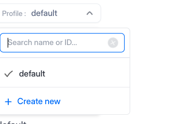<figcaption><p>The profile selector decides which profile your blocklist changes apply to</p></figcaption></figure>

### How blocking works

When the blocklist guard is enabled, Hyperswitch evaluates the card before sending the payment to the processor:

1. Hyperswitch checks the card fingerprint and BIN prefixes against the blocklist.
2. If the card isn't on the blocklist, Hyperswitch checks the card against the attribute rules configured for the business profile.
3. If a blocklist entry or attribute rule matches, the payment is rejected.
4. If there is no match, the payment continues to the configured processor.

### Blocking card payouts

Payments and payouts keep separate fingerprint and BIN lists. In the **Blocklist** section, select **Payout** before adding, checking, unblocking, or exporting a payout entry. An entry on the **Payment** tab does not block payouts, and an entry on the **Payout** tab does not block payments. The profile's **Card** attribute rules are also used for card payouts.

<figure>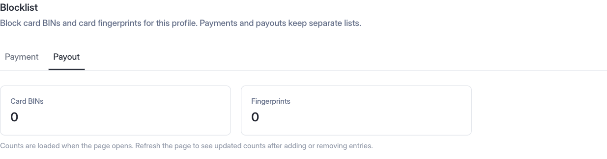<figcaption><p>Payment and payout entries are managed separately</p></figcaption></figure>

When a rule matches, Hyperswitch stops the payout before it reaches the processor and marks it `failed`, with error code `HE-03` and a message explaining the rejection. These checks apply to card payouts; bank and wallet payouts are not checked by this guard.

If a stored connector transfer method provides only a saved BIN, Hyperswitch checks the available BIN prefixes and card attributes. Fingerprint checks require the full card number.

### Before you start

[Contact us](https://hyperswitch.io/contact-us) to enable the blocklist for payments and payouts. Payment and payout enforcement are enabled separately; saving entries or clicking **Update** on card-attribute rules does not enable a guard.

### Step 1: Choose what you want to block

You can configure one or more of the following options.

#### Option 1: Block a specific card

Use a card fingerprint when you want to block one card without blocking other cards from the same BIN range.

After you confirm a card payment, note its card fingerprint from the payment response.
```json
{
   "payment_id": "pay_Gbc5vC0SF4UMGXUm3yvl",
   "merchant_id": "merchant_1705052192",
   "status": "succeeded",
   "amount": 150,
   "net_amount": 150,
   "currency": "USD",
   "amount_received": 150,
   "connector": "stripe",
   "payment_method": "card",
   "payment_method_data": {
       "card": {
           "last4": "4242",
           "card_type": null,
           "card_network": null,
           "card_issuer": null,
           "card_issuing_country": null,
           "card_isin": "424242",
           "card_extended_bin": "42424242",
           "card_exp_month": "03",
           "card_exp_year": "2030",
           "card_holder_name": "joseph Doe"
       }
   },
  
  ...
  
  
   "fingerprint": "CKz5s9W4FX03eydwgGun"
}
```

Open [Payment Settings → Block List](https://app.hyperswitch.io/dashboard/payment-settings), scroll to **Blocklist**, and select **Payment** or **Payout**. Under **Add an entry**, select **Fingerprint**, paste the fingerprint into **Data**, and click **Block**.

<figure>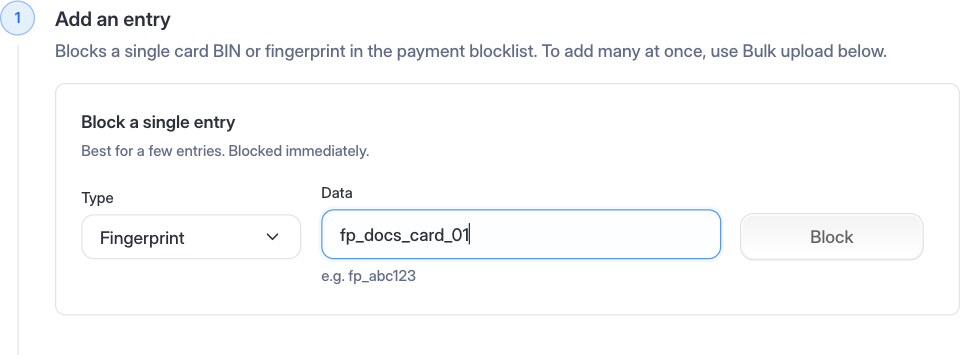<figcaption><p>Blocking a single card by its fingerprint</p></figcaption></figure>

With the corresponding guard enabled, the card is rejected the next time it is used under that business profile and transaction flow.

To block the same card on more than one profile, switch profiles and add it again, or [copy the blocklist between profiles](#copy-a-blocklist-between-profiles). Entries are not automatically shared between profiles.

#### Option 2: Block a card BIN range

Use a BIN block when you want to reject several cards that share the same prefix.

Select **Payment** or **Payout** in **Blocklist**. Under **Add an entry**, select **Generic Card BIN**, enter a prefix of 6 to 10 digits, and click **Block**.

<figure>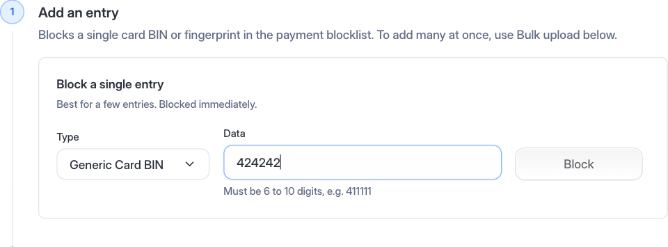<figcaption><p>Blocking every card that starts with a BIN prefix</p></figcaption></figure>

A BIN prefix can match many cards. Use the longest prefix that covers the risky range so legitimate cards aren't blocked unnecessarily.

#### Option 3: Block cards by attribute

Use payment method blocking when you want to enforce an ongoing rule for a category of cards.

Hyperswitch supports the following card attributes:

| API field | What it blocks | Example values |
| --- | --- | --- |
| `issuing_country` | Cards issued in selected countries | `IN`, `US` |
| `card_types` | Credit or debit cards | `credit`, `debit` |
| `card_networks` | Selected card networks | `Visa`, `Mastercard`, `AmericanExpress` |
| `funding_sources` | Cards with selected funding sources | `CREDIT`, `DEBIT`, `PREPAID`, `DEFERRED DEBIT`, `CHARGE CARD` |
| `card_segment_types` | Cards in selected customer or business segments | `business`, `commercial`, `consumer`, `government` |
| `card_subtypes` | Selected card subtypes | A supported card subtype |
| `block_virtual_cards` | Virtual cards | `true` or `false` |
| `block_non_reloadable_prepaid_cards` | Prepaid cards that cannot be reloaded | `true` or `false` |
| `gambling_blocked` | BINs marked for gambling restrictions | `true` or `false` |
| `block_if_bin_info_unavailable` | Cards whose BIN is not available in the card information database | `true` or `false` |

You can block on these from the Control Center, under **Payment Settings → Block List → Payment Method Blocking**. Open the **Card** section, choose the values you want to block, and turn on the switches you need.

<figure>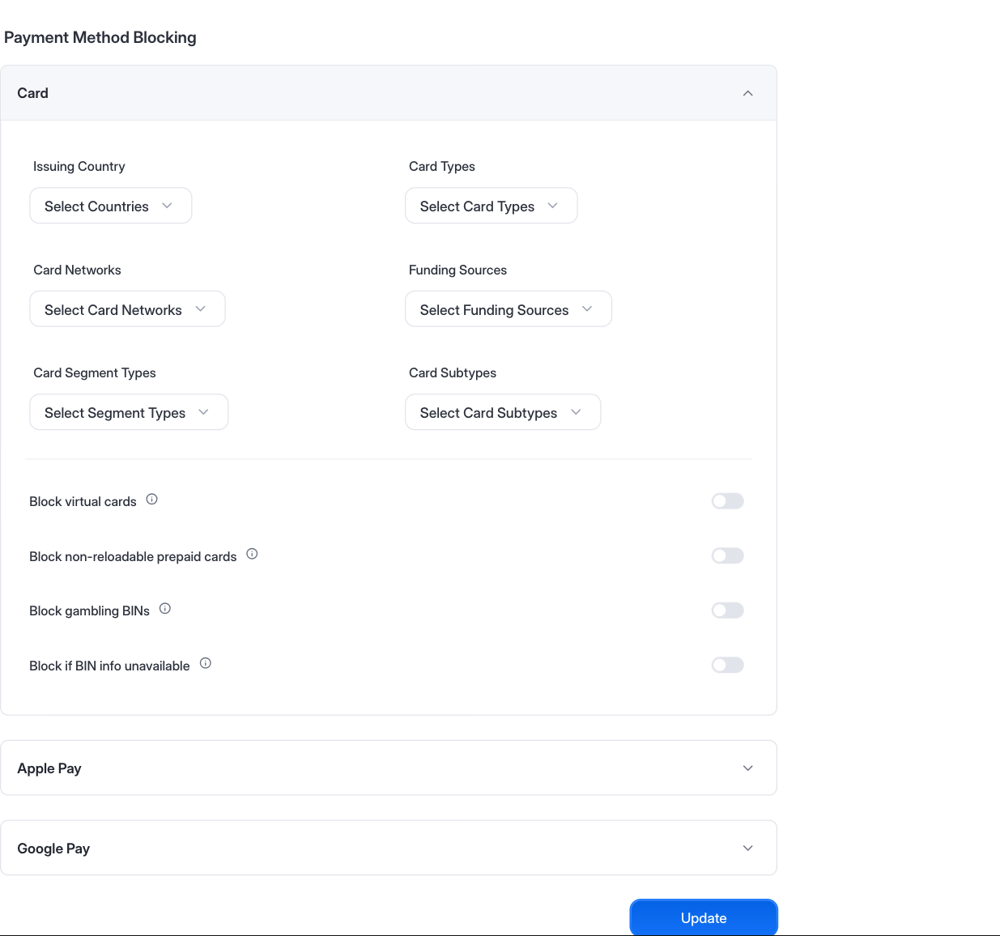<figcaption><p>Card-attribute rules for direct card payments</p></figcaption></figure>

The **Apple Pay** and **Google Pay** sections take the same fields, so you can apply these rules to wallet payments too. They work on the Hyperswitch decryption flow.

<figure>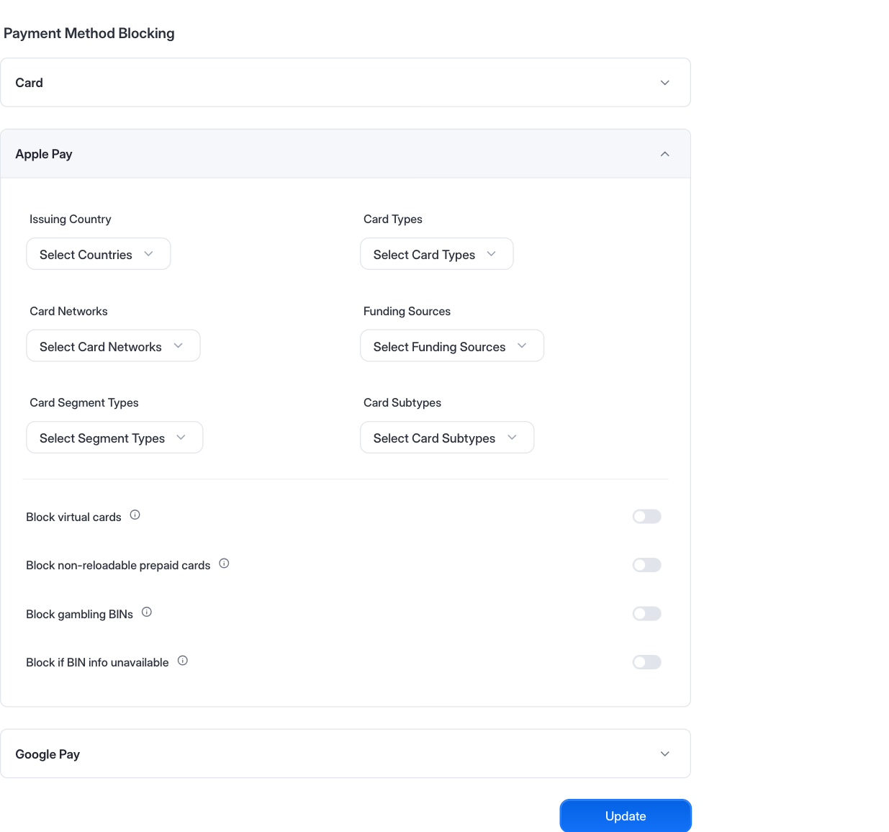<figcaption><p>The Apple Pay section, with its own attribute rules and switches</p></figcaption></figure>

A rule set under **Card** does not carry over to the wallets, so set each section you care about, then click **Update**.

<figure>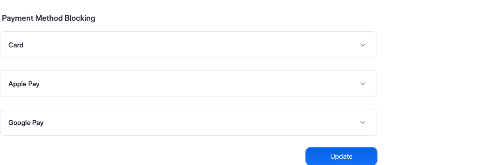<figcaption><p>Card, Apple Pay, and Google Pay each carry their own rules</p></figcaption></figure>

Every field is optional. Set only the rules you need.

Card-attribute rules depend on BIN information. If Hyperswitch has no record for a BIN, the card is allowed by default. Set `block_if_bin_info_unavailable` to `true` if you want to reject cards with an unknown BIN, but test it in the sandbox first: it also rejects legitimate cards whose BIN information isn't catalogued yet.

### Step 2: Test the block

Test the complete flow in the sandbox:

1. Make a payment with a test card and confirm that it succeeds.
2. Add the card fingerprint or BIN to the blocklist, or add an attribute rule that matches the card.
3. Confirm that the blocklist guard is enabled.
4. Retry the payment with the same card.

The second payment should fail before it reaches the processor. A blocked payment has:

* Payment status `failed`
* `merchant_decision` set to `Rejected`
* Error code `HE-03`
* An error message that explains why the card was rejected

Example error response:

```json
{
  "error": {
    "type": "invalid_request",
    "message": "We're unable to accept this card, please try another card or a different payment method",
    "code": "HE-03"
  }
}
```

If your checkout runs the Payments Eligibility API before confirmation, a blocked card returns `sdk_next_action: deny`. The deny action includes a reason code for the rule that matched.

| Reason code | Rule that matched |
| --- | --- |
| `blocked_bin` | A fingerprint or BIN blocklist entry |
| `blocked_card_info_unavailable` | BIN information was not found |
| `blocked_card_type` | Card type |
| `blocked_card_network` | Card network |
| `blocked_funding_source` | Funding source |
| `blocked_card_subtype` | Card subtype |
| `blocked_card_segment_type` | Card segment |
| `blocked_virtual_card` | Virtual card |
| `blocked_non_reloadable_prepaid_card` | Non-reloadable prepaid card |
| `blocked_gambling_card` | Gambling-restricted BIN |
| `blocked_issuer_country` | Issuing country |
| `blocked_issuer` | Card issuer |

## Review and unblock

These are all on the same **Payment Settings → Block List** tab, for the business profile you have selected.

### Remove a fingerprint or BIN

Select the **Payment** or **Payout** tab containing the entry. Under **Check or unblock**, select **Unblock**, choose the same type you used when adding it, enter the value, and click **Unblock**. This removes only the entry in the selected flow; other entries and card-attribute rules can still reject the card.

<figure>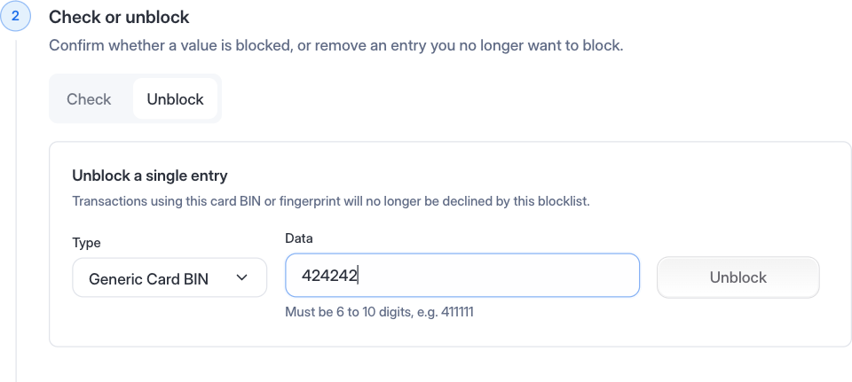<figcaption><p>Removing a single entry from the selected flow</p></figcaption></figure>

### Check whether a value is blocked

Use **Check** to see whether a BIN or fingerprint has a matching entry in the selected list.

Select **Payment** or **Payout**, then open **Check** under **Check or unblock**. Enter the BIN or fingerprint and click **Check**. This checks the stored value across blocklist entry types in the selected flow; it does not evaluate card-attribute rules or confirm that the guard is enabled.

<figure>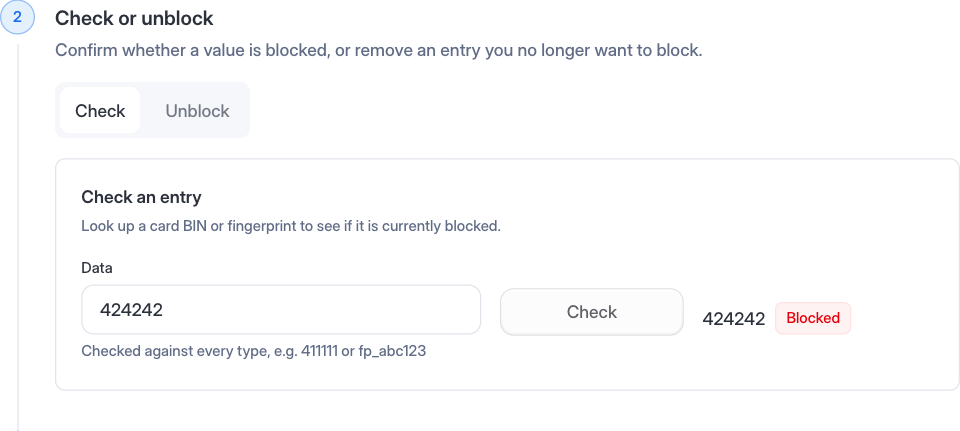<figcaption><p>Checking a value against every blocklist type</p></figcaption></figure>


### See how many entries you have

The **Blocklist** section shows entry counts for the selected **Payment** or **Payout** tab, grouped by BIN length, plus a count of blocked fingerprints.

<figure>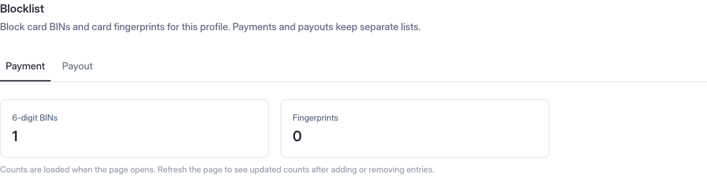<figcaption><p>Entry counts for the selected business profile</p></figcaption></figure>

Counts load when the page opens. Refresh the page to see them change after you add or remove an entry.

For `generic_card_bin`, the count includes entries that were originally added as `card_bin` or `extended_card_bin`.

## Upload a blocklist in bulk

Use a CSV upload when you need to add several fingerprints or BINs.

### Prepare the CSV

Click **Download Sample File** in **Bulk upload and copy**, then fill in the UTF-8 CSV template:

| Column | Required | Description |
| --- | --- | --- |
| `type` | Yes | Use `generic_card_bin` for a 6 to 10-digit BIN prefix, or `fingerprint` for a card fingerprint |
| `data` | Yes | The fingerprint or BIN prefix to block; preserve leading zeros |
| `metadata` | No | Notes in `key=value` format, separated by semicolons |
| `transaction_type` | No | `payment` or `payout`; an empty or omitted value defaults to `payment` |

Bulk upload is shared by both tabs. The `transaction_type` on each CSV row decides which list receives it; the selected tab does not override the CSV. To block a value for both flows, include one row for each flow.

The file can contain up to **100,000 data rows** and must be no larger than **5 MB**.

### Upload from the Control Center

1. Go to **Payment Settings → Block List**, then scroll to **Bulk upload and copy**.
2. Click **Download Sample File** if you need a template.
3. Click **Choose File** and select the CSV.
4. Click **Upload**.
5. Track the upload under **Background jobs**. Use **Refresh** on its row to see the latest status and succeeded/failed row counts. A completed job can still have failed rows; review the counts before relying on the upload.

<figure>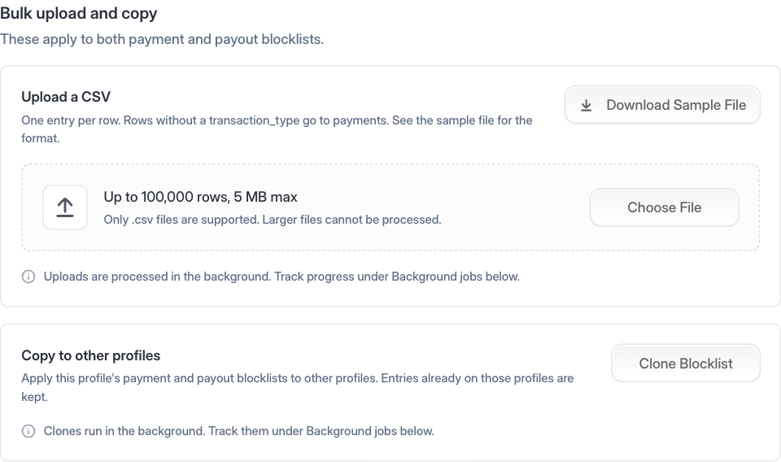<figcaption><p>Uploading a blocklist CSV from the Control Center</p></figcaption></figure>

## Download your blocklist

Export the selected profile's blocklist as a CSV for an audit or to reuse the entries elsewhere:

1. Select **Payment** or **Payout** in **Blocklist**.
2. Under **Export**, click **Generate Export**.
3. Scroll to **Background jobs** and find the export job.
4. Refresh the job until it completes, then click **Download**.

<figure>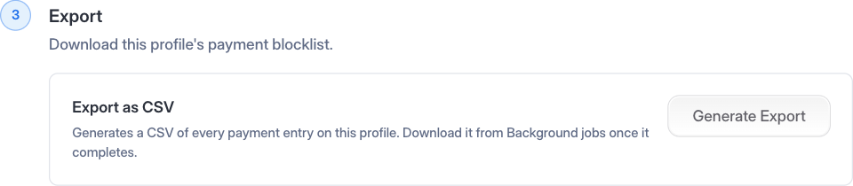<figcaption><p>Generating a CSV for the selected profile and flow</p></figcaption></figure>

The export contains entries for the selected flow, not card-attribute rules. Downloads are available only while the export file has not expired; generate a new export if it is no longer downloadable.

## Copy a blocklist between profiles

1. Select the source profile at the top of **Payment Settings**.
2. Open **Block List**, then scroll to **Bulk upload and copy**.
3. Under **Copy to other profiles**, click **Clone Blocklist**.
4. Select one or more **Target profiles**, then click **Clone**.
5. Track the clone under **Background jobs**, using **Refresh** to see its latest status.

Cloning copies both payment and payout fingerprint and BIN entries to the selected profiles under the same merchant. Entries already on destination profiles are kept. Card-attribute rules are not copied; configure them separately on each destination profile. Profile-level users cannot start a clone.

<figure>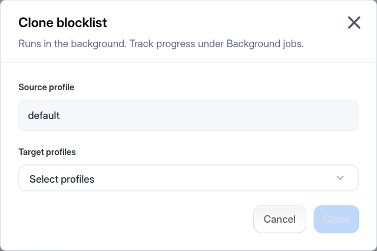<figcaption><p>Choosing the profiles that receive a copy of both lists</p></figcaption></figure>

## Track background jobs

Uploads, exports, and clones appear together under **Background jobs** for the selected profile. Check the job's **Type** and **Status**, and use its **Refresh** action while it is running. Uploads also show succeeded and failed row counts. Completed, available exports have a **Download** action.

<figure>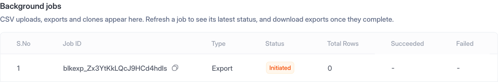<figcaption><p>Tracking an export started from the Control Center</p></figcaption></figure>

## Turn blocking off

To drop a card-attribute rule, open its section under **Payment Method Blocking**, clear the value or switch it off, and click **Update**.

To stop enforcing the lists without deleting their entries, ask your Hyperswitch administrator to disable the corresponding payment or payout guard. Disabling payment enforcement does not disable payout enforcement.
