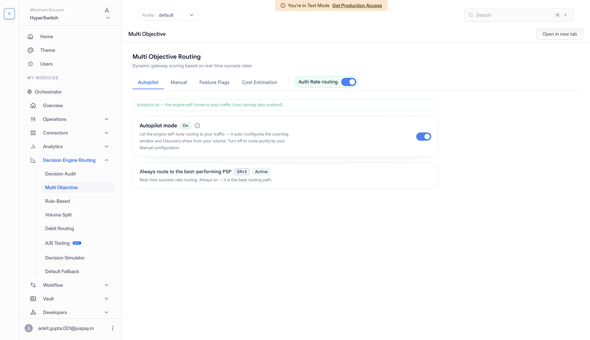

# Auth-Rate Routing

Auth-Rate Routing uses recent payment outcomes to choose the processor most likely to authorize the next payment. It is useful when you have multiple processors for the same payment method and want routing to adapt as processor performance changes.

## How It Works

Hyperswitch uses recent payment outcomes to rank eligible processors. Scores can account for payment attributes such as payment method, currency, card network, and authentication type, depending on your scoring configuration.

Routing balances sending traffic to the best-performing processor with learning about alternatives.

* **Prefer stronger performance.** Send most traffic to the processor with the best recent authorization rate.
* **Keep alternatives measured.** When exploration is enabled, send a smaller share to other eligible processors so their scores stay current.

For example, if Stripe performs better than Adyen for a payment type, Stripe receives more traffic. If Adyen's recent performance improves, routing can shift toward Adyen as new outcomes arrive.

## Merchant Controls

| Control | What it changes | Where to find it |
| --- | --- | --- |
| **Auth Rate routing** | Enables or pauses auth-rate scoring for payment routing. | Switch beside the page tabs. |
| **Bucket size** | How many recent payments contribute to a gateway's score. A smaller value reacts faster. A larger value gives a steadier score. | **Manual** > **Scoring defaults**. |
| **Hedging %** | The share sent to alternative gateways to keep their scores fresh. Requires exploration to be enabled. | **Manual** > **Scoring defaults**. |
| **Latency threshold (s)** | How delayed processor responses affect scoring. | **Manual** > **Scoring defaults**. |
| **Elimination** | Pauses routing to a processor whose recent authorization rate falls below your threshold. | Set the threshold under **Manual** > **Elimination** and enable it under **Feature Flags**. |
| **SR Dimensions** | Which payment attributes are used to score traffic separately. | **Manual** > **SR Dimensions**. |

## Dashboard Setup

Before you start, configure at least two processors that support the payment methods and currencies you want to route. Review the selected profile's [Default Fallback Routing](default-fallback-routing.md).

### 1. Open The Routing Settings

1. Select your merchant account and **Profile** in the dashboard.
2. Go to **Decision Engine Routing** > **Multi Objective**.
3. Locate the **Auth Rate routing** switch beside the page tabs. You can configure Manual settings while this switch is off.

<figure><figcaption>
Auth-rate routing settings are managed on the Multi Objective page.
</figcaption></figure>

### 2. Configure Manual Settings

1. If you want to manage scoring yourself, open **Autopilot** and turn **Autopilot mode** off if it is currently on.
2. Open **Manual** > **Scoring defaults**.
3. Review **Bucket size**, **Hedging %**, and **Latency threshold (s)**.
4. Add **Sub-level overrides** if a payment type needs different settings. Otherwise, the defaults apply.
5. Click **Save changes** and check for the **Configuration saved.** message.

Autopilot manages scoring for automatically tuned traffic groups while it is on. Turning it off returns routing to your Manual configuration and also disables Cost savings and Elimination. Review **Feature Flags** if you want to enable either feature again.

For automatic tuning instead, see [Autopilot](autopilot.md).

### 3. Review Features And Enable Routing

1. Open **Feature Flags** and enable **Explore-exploit on SRv3 (Card)** if you want the card routing model to use your **Hedging %** for exploration.
2. If you want to exclude processors with low recent authorization rates, configure **Manual** > **Elimination**, click **Save Elimination Config**, and enable **Elimination (pause PSPs with low auth rate)** under **Feature Flags**.
3. Turn **Auth Rate routing** on when you are ready to use the configuration.

Saved Manual settings apply while Auth Rate routing is on. If it is already on, saving changes updates the settings used for routing.

For cost-aware routing, see [Multi-Objective Routing](multi-objective-routing.md). To compare a change on a portion of traffic before a wider rollout, see [A/B Testing](ab-testing.md).

## Test Routing Behavior

Use **Decision Engine Routing** > **Decision Simulator** to explore how routing responds to changes in processor performance. Configure auth-rate routing before running the simulation.

1. Set the displayed success rate for each processor.
2. Choose the available payment context, such as currency, card scenario, and amount range.
3. Click **Run simulation**.
4. Review the processor allocation, **First-attempt auth rate**, **Net auth rate**, and **Total decisions**.
5. Change a processor's success rate and run the simulation again to compare the routing choices.

<figure><figcaption>
Set processor success rates and a payment scenario, then run a simulation to review routing behavior.
</figcaption></figure>

Simulation results reflect the scenarios and success rates you enter. Use **Decision Engine Routing** > **Decision Audit** to inspect routing decisions as you monitor your payment traffic.
