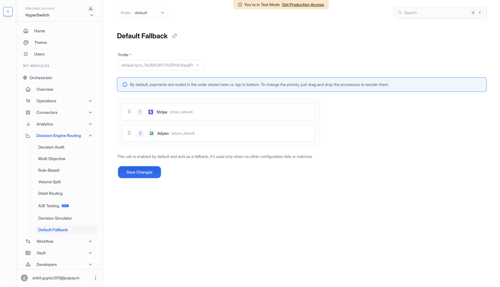

# Default Fallback Routing



Default Fallback Routing is the priority order of configured processors for a merchant profile. Hyperswitch can use this order on its own, or as the backup path when another routing strategy does not return a usable processor.

## When It Applies

Default fallback can be used in the following situations:

* No routing configuration is active.
* A rule or volume split points to a processor that does not support the payment method.
* A processor is temporarily unavailable.
* A dynamic routing result cannot be used safely.

## Setup


If your account still shows the older routing interface, open `Workflow` > `Routing` and click `Manage` for Default Fallback. The steps below describe the Decision Engine Routing interface.


1. Select your merchant account and **Profile** in the dashboard.
2. Go to **Decision Engine Routing** > **Default Fallback**.
3. Confirm the **Profile** on the fallback page and review its configured processors.
4. Drag and drop processors into your preferred priority order, from top to bottom.
5. Click **Save Changes**, then confirm with **Yes, save it**.

<figure> Default Fallback page showing the selected profile, Stripe first and Adyen second, drag handles, priority positions, and Save Changes."><figcaption>
Drag processors into your preferred fallback order, then click Save Changes.
</figcaption></figure>

When no Rule-Based block matches a payment routed through Hyperswitch, this profile-level order is used instead of the rule builder's **Default Fallback Gateway**, provided the profile has a fallback list. Review this order whenever you change your routing configuration.

## Good Practices

Put your most reliable general-purpose processor first, followed by processors that support the broadest set of payment methods and currencies. Review this list whenever you add or remove a connector.
