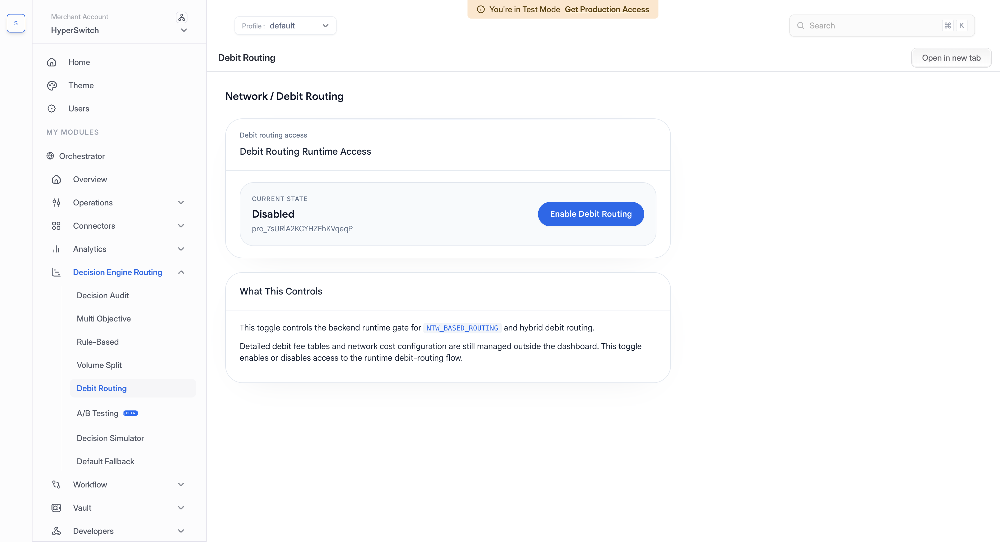
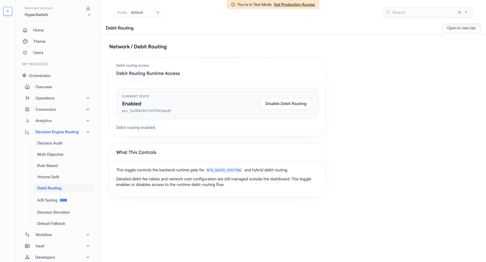

# Least Cost Routing

Least Cost Routing helps merchants reduce debit payment cost by selecting the most cost-efficient eligible debit network for a transaction. In the dashboard, this feature is called **Debit Routing**. It is focused on debit network choice, while [Multi-Objective Routing](multi-objective-routing.md) focuses on processor-level cost and auth-rate tradeoffs.

## Prerequisites

Before enabling Debit Routing, confirm the following requirements.

* Connectors that support local debit network routing are configured.
* Debit card support is enabled.
* Your processors support the local debit networks you intend to use, and the required network eligibility and fee configuration is in place.
* The payment has the debit card and network data required to identify eligible local networks.

## Setup In Decision Engine Routing

### 1. Open Debit Routing

1. Select your merchant account and **Profile** in the dashboard.
2. Go to **Decision Engine Routing** > **Debit Routing**.
3. On the **Network / Debit Routing** page, review **Current state** in the **Debit Routing Runtime Access** card.

If the state is **Disabled**, the action button reads **Enable Debit Routing**. If it is **Enabled**, the button reads **Disable Debit Routing**.

<figure> Debit Routing page showing the selected profile, Current state as Disabled, and the Enable Debit Routing button"><figcaption>
Review the selected profile and current state before enabling Debit Routing.
</figcaption></figure>

### 2. Enable Debit Routing

1. Confirm the processor, debit card, network eligibility, and fee configuration prerequisites above.
2. Click **Enable Debit Routing**.
3. Wait for the confirmation message. Check that **Current state** changes to **Enabled** and the button changes to **Disable Debit Routing**.

The button saves the change immediately. Enabling allows eligible payments to use debit network routing, including when it runs alongside auth-rate routing. The selected network still depends on the available payment data and network configuration.

<figure><figcaption>
Confirm that Debit Routing is Enabled after saving the change.
</figcaption></figure>

## Disable Debit Routing

1. Open **Decision Engine Routing** > **Debit Routing** for the same merchant account and profile.
2. Click **Disable Debit Routing**.
3. Wait for the confirmation message. Check that **Current state** changes to **Disabled** and the button changes back to **Enable Debit Routing**.

Disabling turns off access to debit network routing through this feature, including its use alongside auth-rate routing.

## Supported Configuration

| Item | Supported values |
| --- | --- |
| Geography | US |
| Payment method | Cards |
| Networks | Star, Pulse, NYCE, Accel |

## How It Works

For supported debit card payments, Hyperswitch checks the available card networks and eligible connector capabilities. It compares eligible global and local debit networks and selects the network with the lowest estimated cost.

Least Cost Routing can run as a standalone debit network routing strategy or alongside auth-rate routing in a hybrid setup, where Hyperswitch keeps processor performance in view while also selecting the debit network.

## Cost Computation

Hyperswitch estimates transaction cost using payment attributes such as amount, issuer, network, acquirer country, and merchant category.

<figure><figcaption></figcaption></figure>

The cost computation considers the following inputs.

* Merchant category code (MCC) supplied by the merchant.
* Transaction amount.
* Card issuer bank.
* Co-badged card network data, when available.
* Global network and local network eligibility.
* Default cost values available in Hyperswitch when merchant-specific cost data is not available.
* Merchant-provided PSP-network contracts where those inputs are available.

When supported by the processor, Hyperswitch passes the selected debit network in the payment request.
