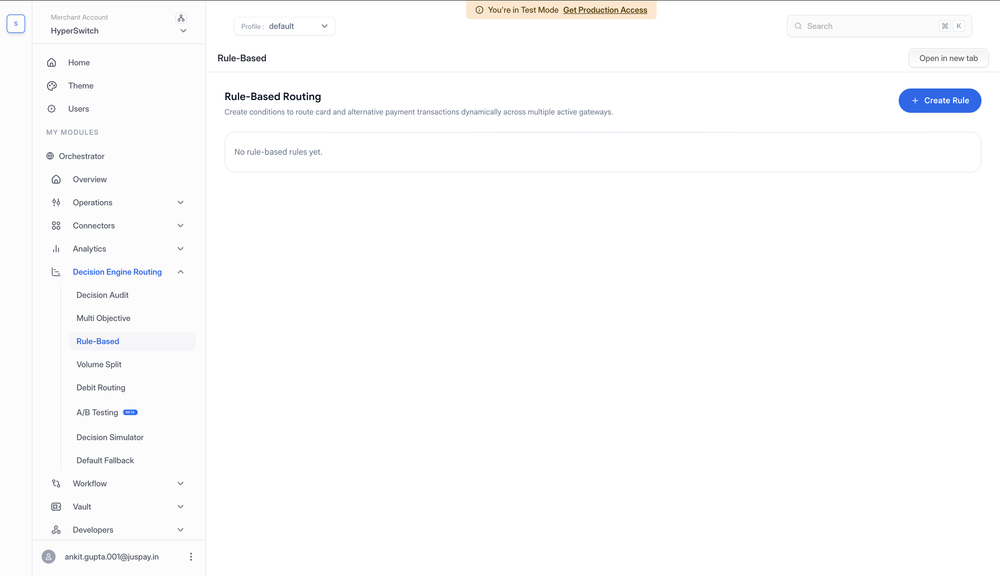
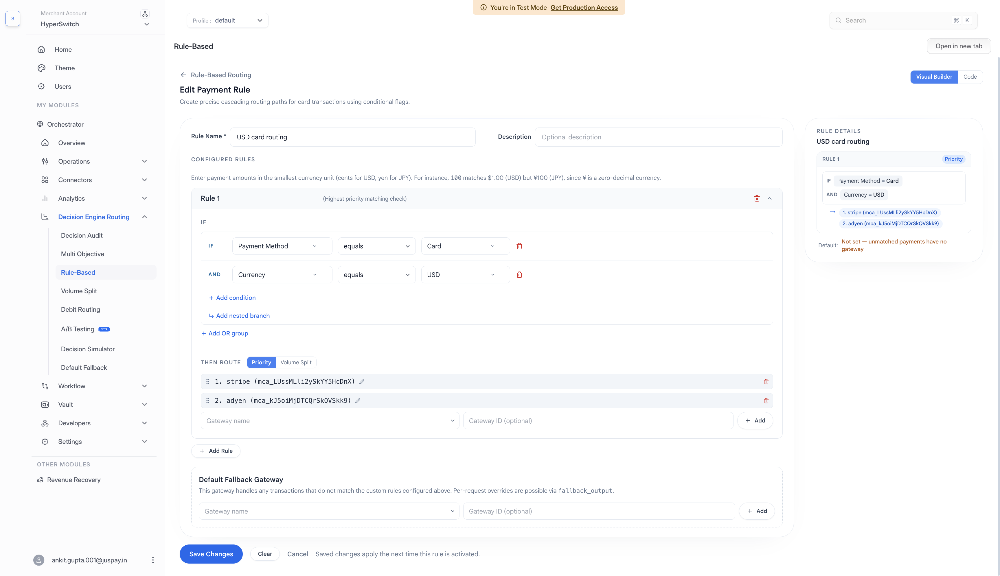
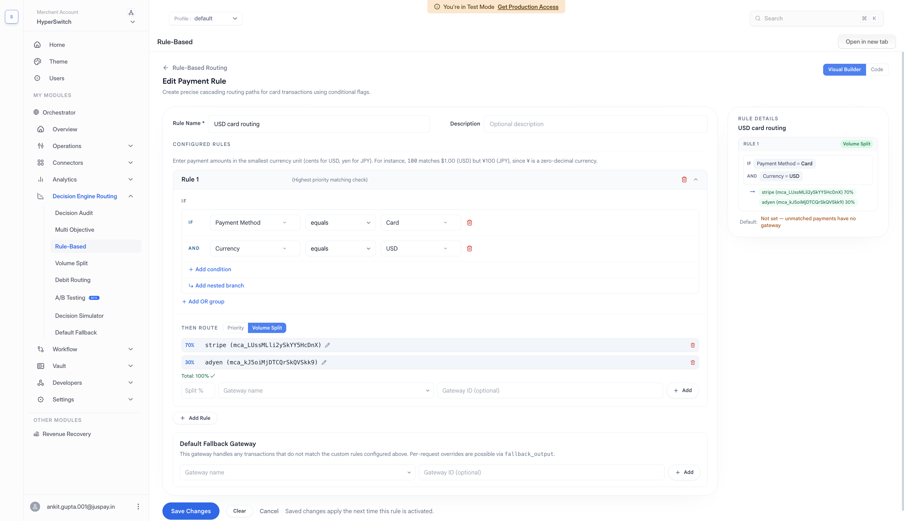
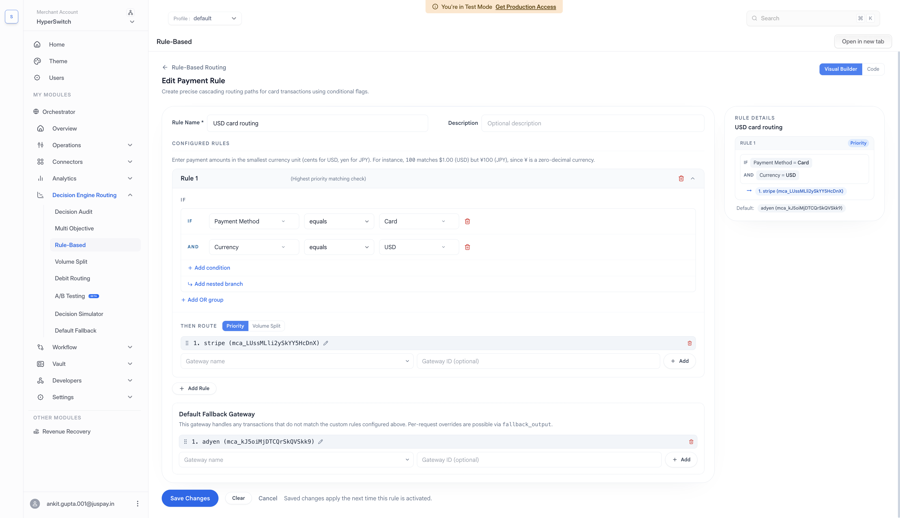
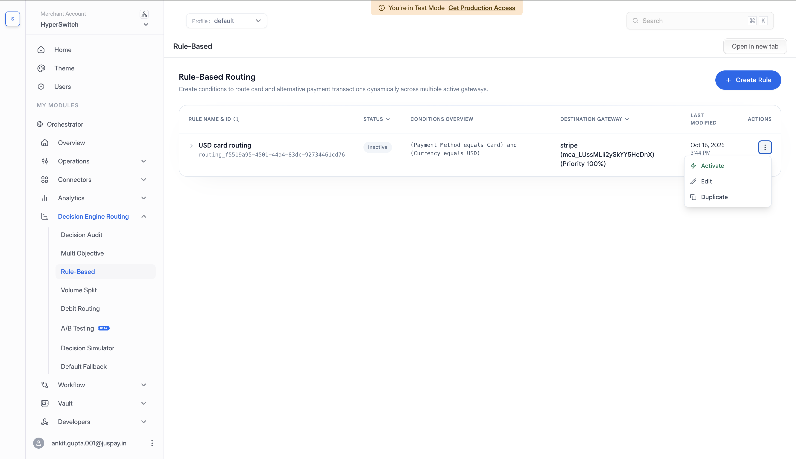
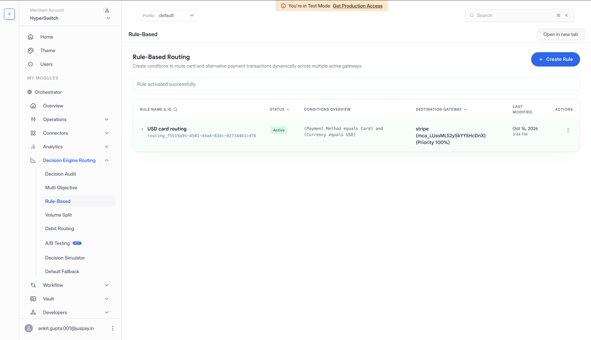

# Rule-Based Routing



Rule-Based Routing lets you choose where to send payments based on conditions such as payment method, currency, or amount. Each condition block pairs your business conditions with a processor preference. The dashboard labels processors as gateways.

## How It Works

One saved routing configuration can contain multiple condition blocks. When that configuration is active, Hyperswitch checks its blocks from top to bottom and uses the first matching block. Later blocks are skipped once a match is found.

This order is the order inside the rule builder, rather than the order of saved configurations on the Rule-Based list. Put specific conditions before broader conditions that could match the same payment.

If no block matches, payments use the fallback order. For payments routed through Hyperswitch, your profile's [Default Fallback Routing](default-fallback-routing.md) takes precedence over the rule builder's fallback when the profile has a fallback list.

### Conditions

Choose a payment field, an operator, and a value. Available fields include payment method, payment method type, amount, currency, billing country, and card network. The operator choices depend on the field. The following examples show common choices.

| Field | Operator examples | Example condition |
| --- | --- | --- |
| Currency or payment method | `equals`, `not equals`, `is one of`, `is not one of` | Currency `equals` USD |
| Amount | `equals`, `not equals`, `greater than`, `less than`, `greater than or equal`, `less than or equal` | Amount `greater than` 10000 |

Use **Add condition** to combine conditions with AND. Every condition in that group must match. Use **Add OR group** for alternatives. A match in any OR group satisfies the block. For example, `Payment Method equals Card AND Currency equals USD` matches only USD card payments.

Enter amounts in the smallest currency unit. For USD, `10000` means $100.00. For JPY, `10000` means ¥10,000.

### Processor Preferences

Under **Then route**, choose a processor preference for payments that match the block.

| Preference | What you configure | How it works |
| --- | --- | --- |
| **Priority** | One processor, or multiple processors in priority order | One processor gives you a single destination. With multiple processors, Hyperswitch prefers the first eligible processor in the list. |
| **Volume Split** | Processors and percentages totaling 100% | Matching payments are distributed by the configured percentages, such as Stripe 70% and Adyen 30%. |

A Volume Split inside a rule applies only to matching payments. Use the separate [Volume-Based Routing](volume-based-routing.md) strategy when you want a split independent of payment conditions.

Retrying a payment after a processor failure depends on your [Smart Retries](../smart-retries/README.md) settings and the reason for the failure.

## When To Use It

Use Rule-Based Routing when you need deterministic control, for example:

* Route a country or currency to a local acquirer.
* Send high-value payments to a processor with stronger risk handling.
* Route a payment method to a processor that has better support for it.
* Keep a processor preference tied to a commercial agreement.

## Setup In Decision Engine Routing

Before you start, connect the processors you want to use for the selected profile and review its [Default Fallback Routing](default-fallback-routing.md). You need permission to manage routing to create or activate a rule.


If your account still shows the older routing interface, open `Workflow` > `Routing` and select `Setup` for Rule-Based Routing. The steps below describe the Decision Engine Routing interface.


### 1. Open The Rule Builder

1. Select your merchant account and **Profile** in the dashboard.
2. Go to **Decision Engine Routing** > **Rule-Based**.
3. Click **Create Rule**.
4. Enter a **Rule Name**, such as `USD card routing`, and an optional **Description**.

<figure> Rule-Based page showing the selected profile, no configured rules, and the Create Rule button."><figcaption>
Open Rule-Based for your selected profile and click Create Rule to configure payment conditions and processor preferences.
</figcaption></figure>

### 2. Configure Conditions And Processor Preferences

For this example, route USD card payments to Stripe first, with Adyen next in the priority order.

1. Under **Configured Rules**, click **Add Rule** to add a condition block. Give it a descriptive name, such as `USD cards`.
2. Set **Payment Method** to `equals` **Card**.
3. Click **Add condition** and set **Currency** to `equals` **USD**. Both conditions must match.
4. Under **Then route**, select **Priority**.
5. Select your configured Stripe processor and click **Add**. Add Adyen next. If you have multiple accounts for a processor, choose the intended account from the processor selector.
6. Drag processors into the required priority order, with Stripe above Adyen.
7. Use **Add Rule** for additional condition blocks. Review their order before saving.

<figure><figcaption>
Both conditions must match. For USD card payments, Priority places Stripe first and Adyen second.
</figcaption></figure>

To split matching payments instead, select **Volume Split** under **Then route**, add the processors and their percentages, and ensure the total is 100%. For example, use Stripe 70% and Adyen 30% for USD card payments only.

<figure><figcaption>
Volume Split distributes matching USD card payments across Stripe at 70% and Adyen at 30%.
</figcaption></figure>

### 3. Review The Fallback

In **Default Fallback Gateway**, add the processors to use when no condition block matches. Drag them into your preferred order.

Also review **Decision Engine Routing** > **Default Fallback** for the selected profile. When routing payments through Hyperswitch, the profile's fallback list takes precedence for unmatched payments. Keep it aligned with the fallback you intend to use.

<figure><figcaption>
Review Default Fallback Gateway and the completed configuration in Rule details before saving.
</figcaption></figure>

### 4. Save And Activate

1. Review the conditions, processor preferences, and fallback, then click **Create Rule**.
2. On the Rule-Based list, find your saved configuration. Its status is **Inactive**. Saving alone does not change payment routing.
3. Open its actions menu and select **Activate**.
4. If a Volume Split rule is active, review the replacement confirmation and click **Yes, activate** to switch to Rule-Based Routing.
5. Confirm that the configuration's status is **Active**.

<figure><figcaption>
Saved configurations remain inactive until you select Activate from the actions menu.
</figcaption></figure>

Activating a different configuration replaces the currently active configuration for these payments. In particular, activating Rule-Based Routing automatically deactivates the active Volume Split rule.

<figure><figcaption>
Confirm that your configuration is Active and review its conditions and destination processor.
</figcaption></figure>

### Example Payment Outcomes

With the Priority example active, payments follow these paths.

| Payment | Routing outcome |
| --- | --- |
| A card payment in USD | Matches `USD cards`. Stripe is preferred, followed by Adyen, subject to processor eligibility. |
| A card payment in EUR | Does not match `USD cards`. Later blocks are checked. If none match, the profile's Default Fallback is used. |
| A payment matching `USD cards` and a later block | Uses `USD cards` because it is the first matching block. |

## Update Or Deactivate A Rule

To update an inactive configuration, open its actions menu, select **Edit**, make your changes, and click **Save Changes**. Activate it when you are ready to use the changes.

To change an active configuration while keeping it in use, select **Duplicate** from its actions menu. Update the copy and click **Create Rule**. The copy is saved as **Inactive**. Activate the copy when it is ready to replace the original.

To stop using a configuration, select **Deactivate** and confirm. It remains saved and can be activated again. Review your profile's Default Fallback before deactivating routing.

## Good Practices

Keep specific condition blocks above broad ones. Check that the selected processors support the payment methods and currencies you route to them. Review your profile's Default Fallback whenever you add or remove a processor.

## How Rule-Based Routing Works


