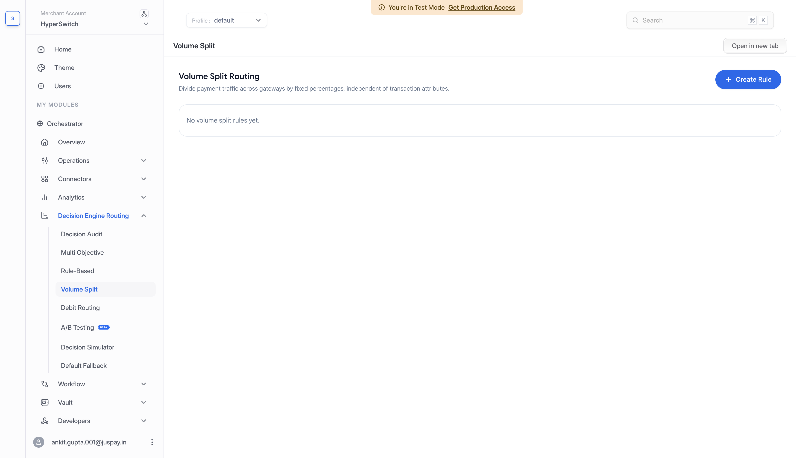
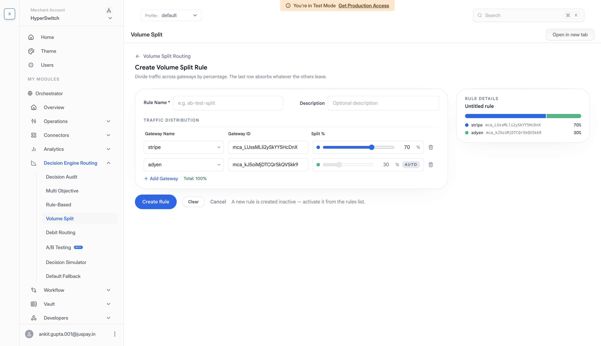
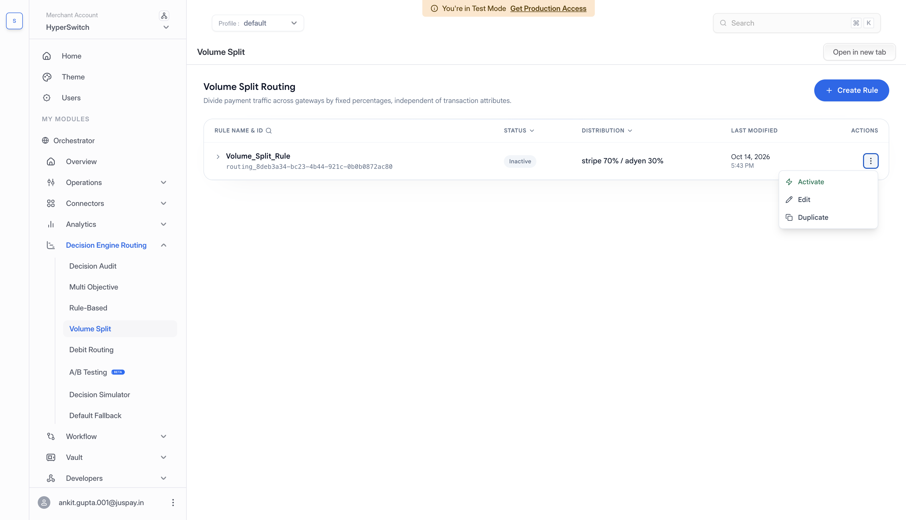
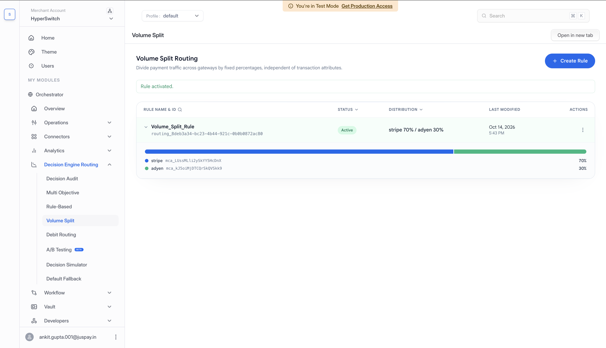

# Volume-Based Routing



Volume-Based Routing distributes payment traffic across processors using fixed percentages, independent of transaction attributes. In the dashboard, this strategy is called **Volume Split**. The dashboard labels processors as gateways.

## How It Works

For each payment, Hyperswitch uses the configured percentages to choose the preferred processor. With Stripe at 70% and Adyen at 30%, each payment has a 70% chance of preferring Stripe and a 30% chance of preferring Adyen.

These percentages describe traffic allocation across many payments. They do not guarantee that exactly seven out of every ten payments go to Stripe. Processor eligibility and fallback can also affect the final distribution. Each payment is assigned a preferred processor. The split does not divide an individual payment amount.

The separate Volume Split strategy applies without payment conditions. To split only a subset of traffic, such as USD card payments, use **Volume Split** within a [Rule-Based Routing](rule-based-routing.md) condition block.

## When To Use It

Use Volume-Based Routing to manage traffic allocation:

* Gradually move traffic to a new processor.
* Keep multiple processors active.
* Meet a planned traffic allocation.
* Run a simple production rollout before switching to a dynamic strategy.

## Setup In Decision Engine Routing

Before you start, connect the processors you want to use for the selected profile and review its [Default Fallback Routing](default-fallback-routing.md). You need permission to manage routing to create or activate a rule.


If your account still shows the older routing interface, open `Workflow` > `Routing` and select `Setup` for Volume-Based Routing. The steps below describe the Decision Engine Routing interface.


### 1. Open Volume Split

1. Select your merchant account and **Profile** in the dashboard.
2. Go to **Decision Engine Routing** > **Volume Split**.
3. Click **Create Rule**.
4. Enter a **Rule Name**, such as `Stripe 70 Adyen 30`, and an optional **Description**.

<figure> Volume Split page showing the selected profile, no configured volume split rules, and the Create Rule button."><figcaption>
Open Volume Split for your selected profile and click Create Rule to configure a traffic split.
</figcaption></figure>

### 2. Set The Traffic Distribution

For a 70% Stripe / 30% Adyen allocation, follow these steps.

1. Under **Traffic Distribution**, select your configured Stripe processor in the first row and Adyen in the second row. Selecting a configured processor fills its **Gateway ID**. If you have multiple accounts for a processor, choose the intended account.
2. Set Stripe's **Split %** to **70** using the percentage field or slider.
3. The last row automatically receives the remaining percentage. Adyen shows **30%** with an **Auto** label. You do not edit that percentage directly.
4. Check that **Total** shows **100%** and review the allocation in **Rule details**.

Use **Add Gateway** to include more processors, or remove a row you no longer need. The final row always receives the remainder. If the other rows exceed 100%, reduce their percentages before saving.

<figure><figcaption>
Set Stripe to 70%. Adyen receives the remaining 30% automatically, with the full allocation shown in Rule details.
</figcaption></figure>

### 3. Save And Activate

1. Click **Create Rule** to save the split.
2. Find the saved rule on the Volume Split list. Its status is **Inactive**. Saving alone does not change payment routing.
3. Open its actions menu and select **Activate**.
4. If a Rule-Based configuration is active, review the replacement confirmation and click **Yes, activate** to switch to Volume Split.
5. Confirm that the split's status is **Active**.

<figure><figcaption>
Saved splits remain inactive until you select Activate from the actions menu.
</figcaption></figure>


Activating Volume Split replaces the active Rule-Based configuration for these payments. The Rule-Based conditions stop applying. Activating Rule-Based Routing later replaces the active Volume Split rule.


<figure><figcaption>
Confirm that the split is Active. Expand the row to review the configured 70% Stripe and 30% Adyen allocation.
</figcaption></figure>

## Change Or Deactivate A Split

To update an inactive split, open its actions menu, select **Edit**, change the allocation, and click **Save Changes**. Activate it when you are ready to use it.

To adjust an active split while keeping it in use, select **Duplicate**, update the copy, and click **Create Rule**. The copy is saved as **Inactive**. Activate it when you are ready to replace the original split.

To stop using a split, select **Deactivate** and confirm. It remains saved and can be activated again.

## Notes

Choose processors that support the payment methods and currencies you intend to route. An ineligible preferred processor can change the final allocation. Keep [Default Fallback Routing](default-fallback-routing.md) configured so payments have a backup path when the routing result does not provide an eligible processor.
