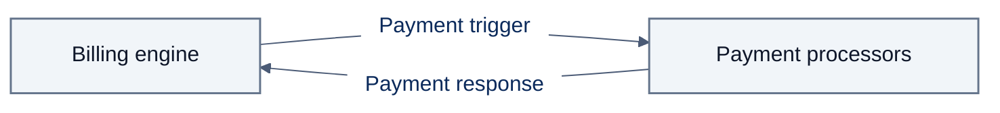
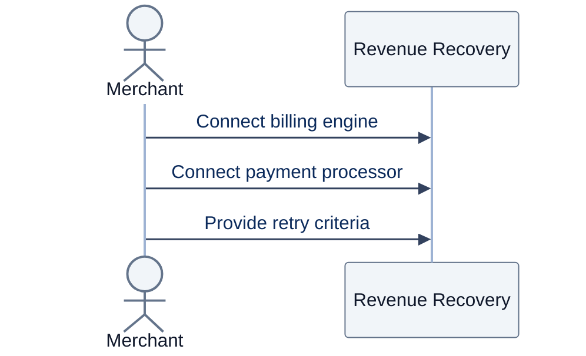
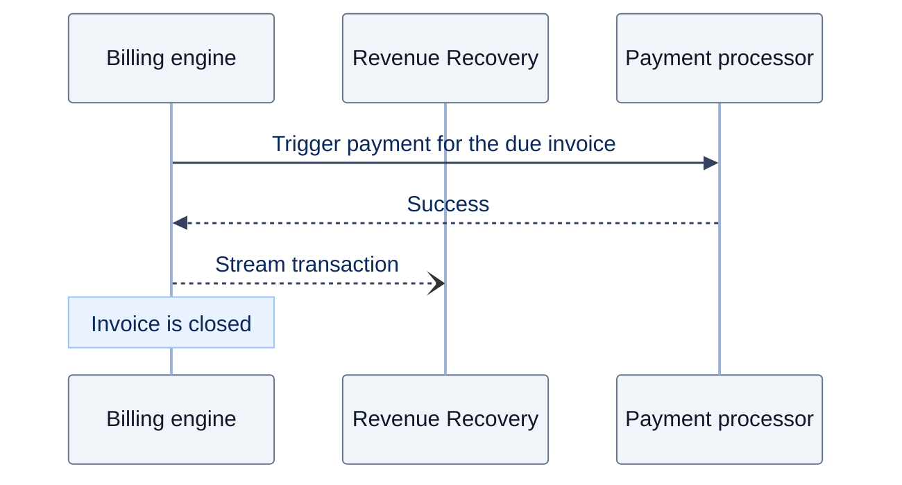
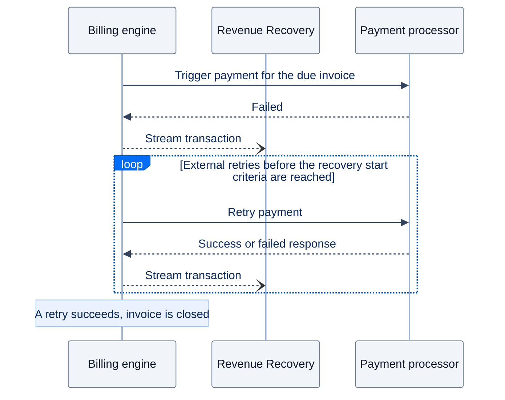
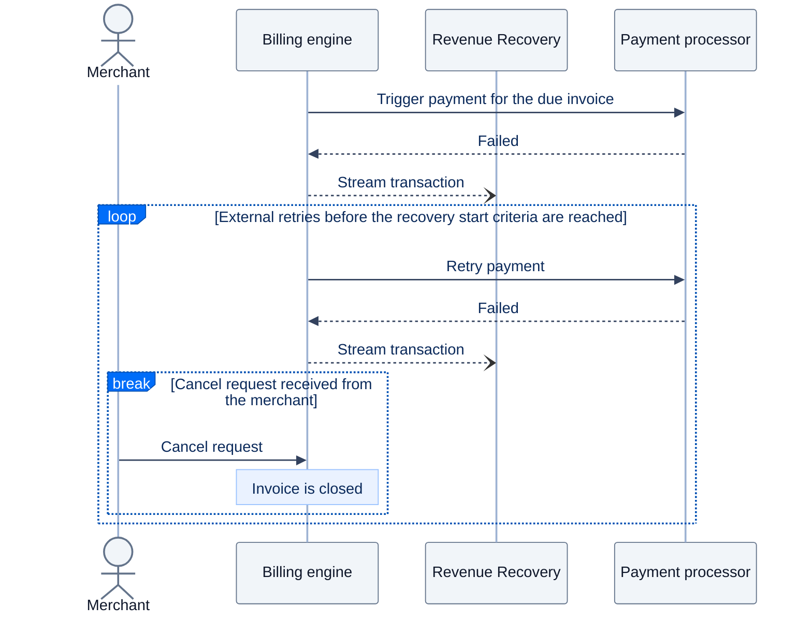
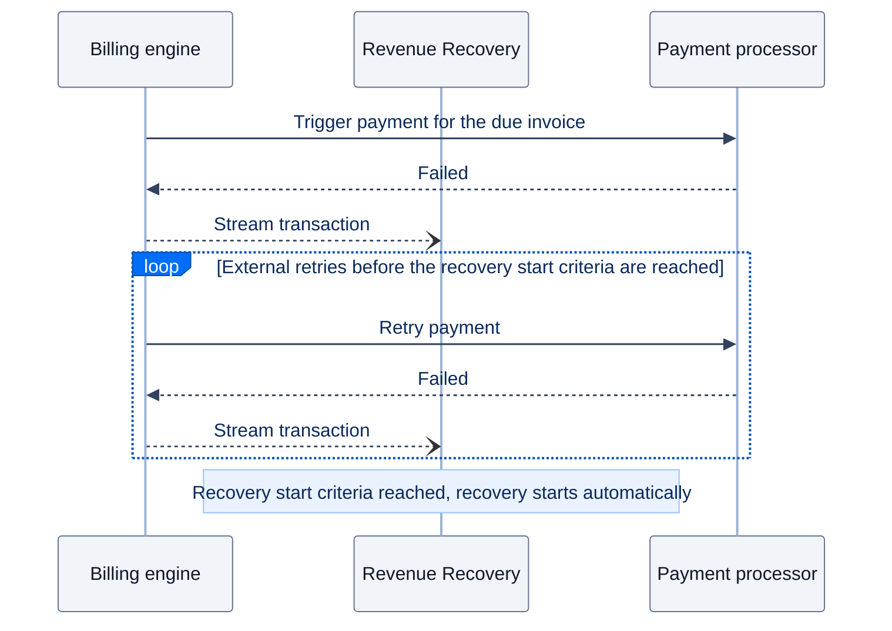
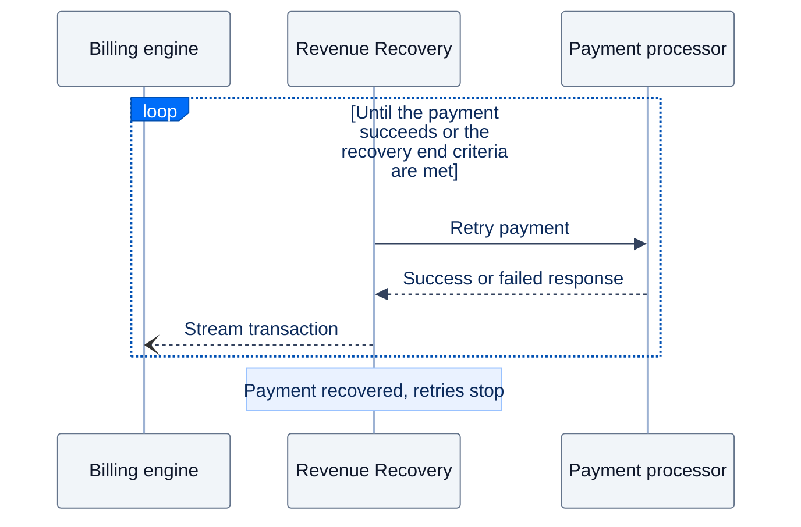
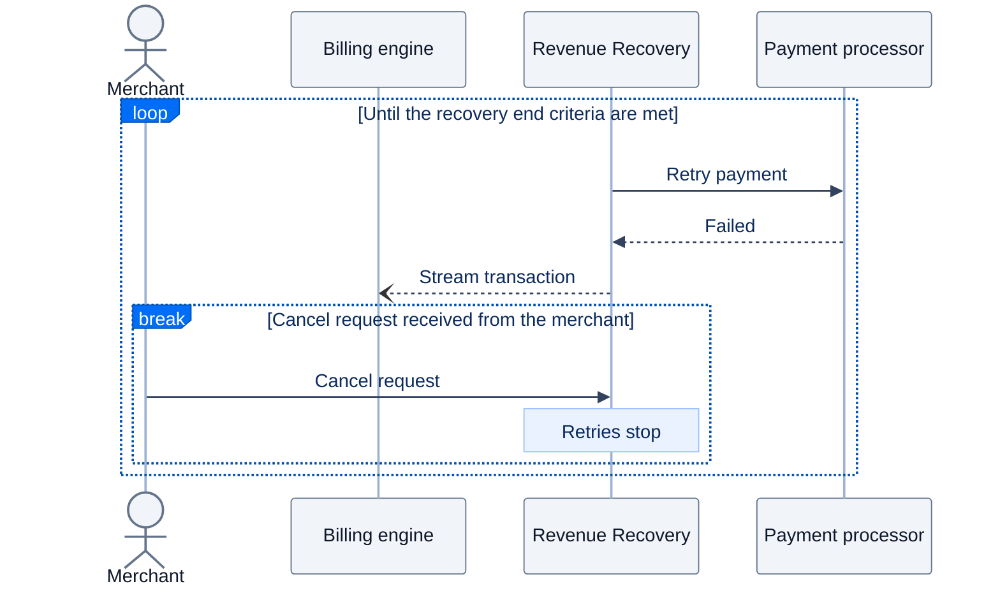
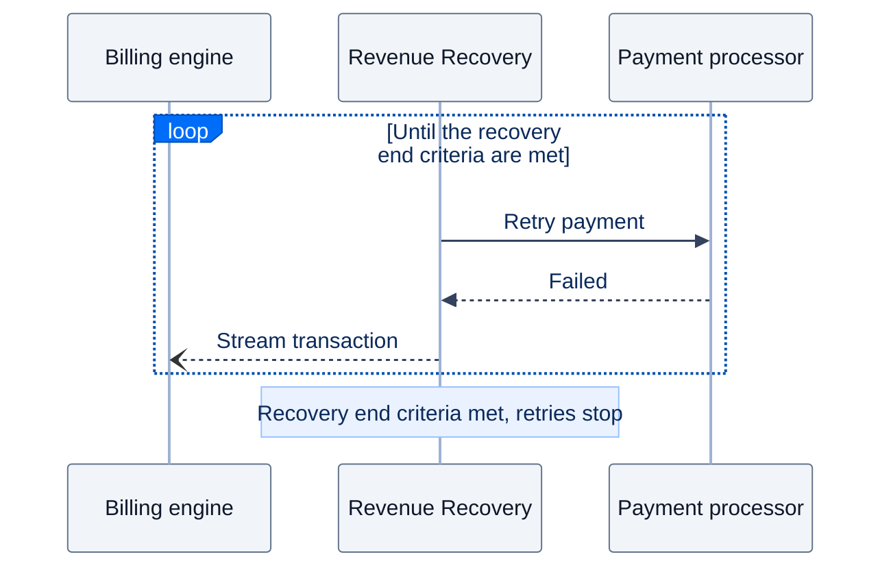

# How Revenue Recovery Works

### What systems are involved?

Revenue Recovery works alongside two systems that most subscription businesses already have in place: a billing engine and one or more payment processors.

**Billing engine**

The billing engine manages the scheduling, invoice generation and payment collection for all recurring plans created by the merchant. It can be a SaaS subscription platform such as Chargebee, Stripe Billing etc., or an in-house billing engine built by the merchant.

**Payment processors**

Payment processors are the systems that actually charge the customer. They are usually integrated with the billing engine, which uses them to automatically charge a customer when an invoice is due. These can be any PSP, such as Stripe, Adyen, PayPal etc., or a payment orchestrator like Hyperswitch.

### How does Revenue Recovery fit into this setup?

Revenue Recovery acts as a third-party plugin between the merchant's billing engine and payment processors.

```mermaid
%%{init: {'theme':'base','themeVariables':{'fontFamily':'Inter, Arial, sans-serif','lineColor':'#4B5B76','primaryTextColor':'#0B2A5B','edgeLabelBackground':'#FFFFFF'},'flowchart':{'padding':16,'nodeSpacing':70,'rankSpacing':150}}}%%
flowchart LR
    BE["#160;#160;#160;Billing engine#160;#160;#160;"] -- "#160;#160;#160;Failed invoices#160;#160;#160;" --> RR["#160;#160;#160;Revenue Recovery#160;#160;#160;"]
    RR -- "#160;#160;#160;Recovery responses#160;#160;#160;" --> BE
    RR -- "#160;#160;#160;Retry payment trigger#160;#160;#160;" --> PP["#160;#160;#160;#160;Payment processor#160;#160;#160;#160;"]
    PP -- "#160;#160;#160;Payment response#160;#160;#160;" --> RR

    classDef ext fill:#F1F5F9,stroke:#64748B,stroke-width:1.5px,color:#0F172A
    classDef rr fill:#006DF9,stroke:#0050B3,stroke-width:1.5px,color:#FFFFFF
    class BE,PP ext
    class RR rr
```

It gets activated when a recurring payment fails. Revenue Recovery then retries the failed payment with the payment processor on behalf of the billing engine, and once the payment is captured, records the result back into the billing engine.

### How is Revenue Recovery activated?

Revenue Recovery is activated automatically based on the recovery start criteria set by the merchant. Until they are reached, your recurring payments work exactly as they do today.

In all the flows below, Revenue Recovery receives a stream of every transaction made by the billing engine. Every transaction made by Revenue Recovery is also streamed back to the billing engine.

**One-time setup**

The merchant connects the billing engine and the payment processor to Revenue Recovery once, and provides two sets of criteria that control the recovery cycle.

**Recovery start criteria** decide when Revenue Recovery starts retrying. Once they are reached, the recovery cycle begins automatically.

* **Start of recovery:** After how many external retries (retries done by the billing engine) should the recovery process start?

**Recovery end criteria** decide when Revenue Recovery stops retrying. Once they are met, the recovery cycle ends and the invoice is closed.

* **Grace period:** What is the grace period from the first payment failure within which retries can be performed?
* **Total retries:** What is the total number of retries, including external retries, that should be done within the grace period?

#### When is Revenue Recovery not involved?

When an invoice is due, the billing engine makes the payment directly with the payment processor, as it does today. Revenue Recovery is not involved at this stage. What happens next depends on the outcome of the payment.

**Scenario 1: Payment is successful**

The recurring payment is successful. The invoice is closed and does not enter the recovery cycle.

**Scenario 2: Payment fails but the invoice is recovered within the retry criteria**

The recurring payment fails but the invoice is recovered by the billing engine's retries before the recovery start criteria are reached. The invoice is closed and does not enter the recovery cycle.

**Scenario 3: Payment fails and invoice is cancelled by the merchant**

The recurring payment fails and invoice is cancelled by the merchant before the recovery start criteria are reached. The invoice is closed and does not enter the recovery cycle.

#### When is Revenue Recovery involved?

The recurring payment fails and is not recovered before the recovery start criteria are reached. The invoice enters the recovery cycle, where it is retried until the recovery end criteria are met. The recovery cycle ends in one of the three ways described below.

**Scenario 1: Payment is recovered**

A retry succeeds before the recovery end criteria are met. The process is stopped and the invoice is closed.

**Scenario 2: Merchant cancels the recovery**

A cancel request is received from the merchant before the recovery end criteria are met. The process is stopped and the invoice is closed.

**Scenario 3: Payment is not recovered**

No successful payment is received before the recovery end criteria are met. The process is stopped and the invoice is closed.

**Note:** When Start of recovery is set to 0, the invoice will be picked up for retry right after the first failed transaction.
